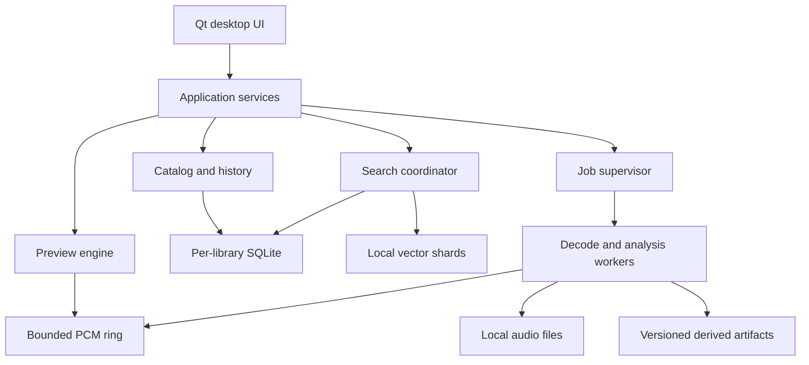
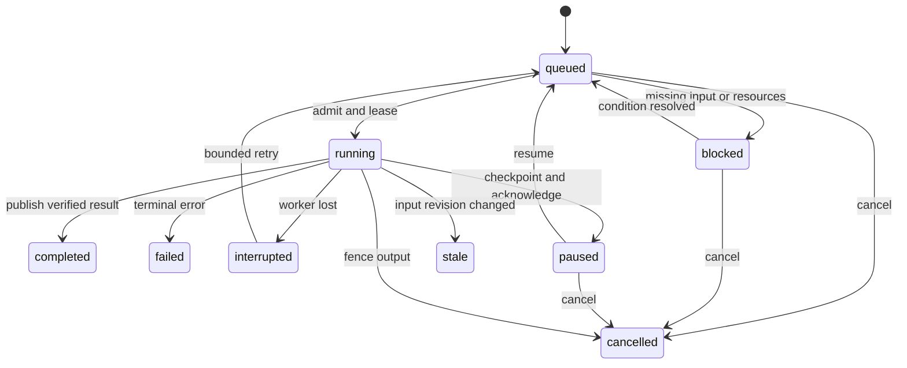

# Music Sample Organizer — Complete Engineering Specification

Version 1.0 · 2026-10-19 · Implementation handoff

A fully offline Windows desktop application for organizing, searching, analyzing and previewing millions of audio samples. Fixed stack: C++23, Qt 6 Widgets and per-library SQLite. This document specifies the product to build; it does not claim that the application is implemented or that performance targets have been measured.

This is the self-contained file to feed an implementation LLM. Start with the execution prompt in chapter 08, then implement P0 and P1. Subsequent phases remain required. Confirmed decisions, engineering defaults and empirical gates are explicitly distinguished. No additional product questions are needed to begin.

## Contents

1. Product requirements and confirmed decisions
2. Component architecture and execution model
3. Persistence, search and metadata history
4. Service contracts, protocols and errors
5. Local audio analysis and retrieval
6. Performance, validation, recovery and release operations
7. Phased delivery and acceptance backlog
8. LLM implementation prompt
9. Decisions, risks and primary technical references
10. Repository agent rules
11. Executable reference SQL schema
12. Validation scope and source checksums

The numbered source documents and SQL schema in the accompanying Git repository are authoritative. This file is generated by `tools/build_handoff.py`.

---

# 01 — Product and technical requirements

## 1. Authority and interpretation

Version 1.0, dated 2026-10-19. This is an implementation specification, not an assertion that the application exists. MUST is a release requirement; SHOULD allows a documented, evidence-backed exception; MAY is optional. All times in persistent records are UTC Unix milliseconds unless a field says otherwise. Binary sizes use KiB/MiB/GiB; latency uses milliseconds; sample rates use Hz.

The present brief and recovered decisions about this specific organizer are binding. Defaults below resolve unspecified details. They are not retroactively attributed to the user. A phase postpones a capability; it does not remove it. Do not reopen settled choices just to start implementation.

## 2. Confirmed scope

| ID | Binding decision | Verification |
| --- | --- | --- |
| R01 | Fully offline Windows desktop application; no accounts or cloud APIs | First-run and feature suite with network blocked |
| R02 | C++23 core, Qt 6 UI, SQLite database per portable library | Build and dependency inspection |
| R03 | Millions of samples; strict bounded memory and responsive browsing | 1M and 5M benchmark gates |
| R04 | Import ordinary metadata automatically; expensive audio analysis requires explicit user action | Import trace contains no full audio-analysis jobs |
| R05 | Referenced folders and managed library copies | End-to-end tests of both modes |
| R06 | Track additions, deletions, moves, renames; unresolved changes go to review; never auto-delete originals | Filesystem and ambiguity fixtures |
| R07 | Open and search multiple libraries together | Federated query and partial-failure tests |
| R08 | Unavailable samples retain searchable metadata; disable playback; no offline audio copies | Disconnect tests for source and catalog volumes |
| R09 | Persistent analysis queue with pause, resume, cancellation, resource limits, customizable profiles | Restart and worker-kill tests |
| R10 | Common audio formats, including AAC and Opus | Versioned decoder capability corpus |
| R11 | Detailed sortable table and visual waveform browser | Both views share selection and filters |
| R12 | Bulk tags, rename, merge, hierarchical tags, suggestions | History and taxonomy tests |
| R13 | Customizable panels, columns, saved layout presets | Restart and monitor-change tests |
| R14 | Folder and category navigation, with filters in either | Query-equivalence tests |
| R15 | Manual and dynamically updated smart collections | Membership and query invalidation tests |
| R16 | Persistent metadata history and undo/redo across restarts | Kill/restart at every mutation boundary |
| R17 | Customizable keyboard shortcuts | Conflict detection and persistence tests |
| R18 | Import progress and cancellation | Partial-commit and resume fixtures |
| R19 | Export metadata to CSV and JSON | Round-trip schema and escaping tests |
| R20 | Database migrations with backup, verification, failure recovery | Upgrade and interrupted-migration matrix |
| R21 | Local natural-language search and audio similarity | Retrieval evaluation and no-network tests |
| R22 | Local classification, BPM detection, key estimation | Held-out audio evaluation |
| R23 | Playback V1: play/pause/seek/waveform | Audible vertical slice and transport tests |
| R24 | Playback V2: loop, pitch shift, speed, volume | DSP and transport tests |
| R25 | Playback V3: BPM sync, beat-aligned loops, tempo-aware preview | Beat and stretch tests |
| R26 | Drag samples into DAWs in V1; VST3 integration later | Windows DAW interoperability tests |
| R27 | Exact, cross-format equivalent, and near-duplicate detection; no automatic deletion | Duplicate ground-truth corpus |
| R28 | Incremental delivery with an early useful application | Each milestone produces a runnable package |

## 3. Resolved defaults

| Decision | Chosen default and rationale |
| --- | --- |
| Platform | Windows 11 x64, including N editions; no dependence on OS media codec packs. Windows 10 and ARM64 are not release targets. |
| Toolchain | MSVC ABI, MSVC or clang-cl with required C++23 feature probes; CMake and Ninja; one pinned compiler/SDK/Qt set in P0. No requirement to use every C++23 feature. |
| UI | Qt Widgets, `QMainWindow`, dock panels, custom paged `QAbstractItemModel`; `QPainter` waveform rendering first. No embedded browser. |
| Audio output | WASAPI shared mode first, through a small audio adapter; miniaudio is the initial output backend candidate. Device sample rate conversion is explicit. Exclusive mode/ASIO are outside V1. |
| Codec adapter | Pinned FFmpeg libraries in worker processes; local file handles and bounded reads. Decode PCM/float, resample with libswresample. No OS codec dependence. |
| Query intelligence | Structured filter parser plus a local joint audio/text embedding model. No generative LLM is required and no model may generate SQL. |
| Model runtime | ONNX Runtime CPU baseline, one lazy-loaded session per model role; optional GPU execution only after CPU correctness. |
| Model selection | A CLAP-family checkpoint is a candidate, not an approved redistributable dependency. Select and validate an exact model pack during P5 under the gate in document 05. |
| Similarity index | USearch C++ adapter, immutable, memory-mapped shards, bounded mutable delta; native Windows smoke test in P0 and scale gate before P5. Exact search is the small-corpus fallback. |
| Sample identity | One logical sample per imported file occurrence; explicit alternate locations can be attached after verified relink. Duplicate detection groups records without collapsing them. |
| Metadata ownership | User tags, categories, ratings, notes and overrides live in SQLite. No embedded audio metadata writes in scope. Extracted, inferred and user values remain distinguishable. |
| Simple organizing fields | Favorite, rating 0–5 (0 means unrated), free-text notes, editable display name. Original filename stays visible. |
| Audio modification | Non-destructive preview processing only. No editor, stem separation, recorder, sequencer, or sample renderer in core scope. |
| Libraries | Up to 8 simultaneously active/searchable libraries in the supported configuration; disk-backed registry may remember more. Warn rather than silently dropping scope beyond the supported limit. |
| Cross-library edits | Explicit independent operations per library with partial-success reporting. No distributed atomicity. |
| Source filesystems | Local NTFS and exFAT source volumes; local NTFS writable catalog storage is the supported baseline. Read-only sources work. No network paths, URLs, cloud placeholders that require hydration, or archive traversal. |
| Portable catalogs | Closed catalog directories are movable. Managed audio is relative to the catalog; referenced roots are rebound by identity/path mapping. Safe-export prepares a consistent portable directory. |
| Offline state | Source disconnected with catalog online: full metadata remains editable. Catalog disconnected: read-only local metadata mirror with a displayed revision watermark. |
| Privacy | No telemetry, crash upload, automatic update checks, online help assets, or runtime downloads. Logs are local and bounded. |
| Distribution | Offline installer/ZIP plus separate offline model pack. Core search and playback work without a model. Developer dependency fetching is allowed during a deliberate bootstrap step. |
| Source license | Not selected by this document. Preserve third-party licenses; do not invent ownership or choose the project's public license. |

## 4. Definitions

A **library** is a catalog directory with a stable UUID, SQLite database and versioned sidecars. A **root** identifies a source directory, mode, and local volume binding. A **sample** is the stable catalog record to which user metadata belongs. A **location** is a file occurrence reachable through a root and relative path. A **content revision** changes when audio bytes may have changed. A **metadata revision** changes when catalog state changes. A **job** is one durable unit of work against a fixed input revision. An **analysis run** is a user-requested group of jobs with an immutable profile snapshot. An **artifact** is derived data indexed by content and algorithm/model versions. A **mirror** is a local read-only catalog replica, not an audio cache and not a replacement for backup.

Separate these concepts. A path is not a stable identity. A fingerprint is not proof of equality. A missing file is not a deleted catalog record. An embedding model's cosine score is not a probability. A waveform is not audio that can be replayed.

## 5. Primary workflows

### 5.1 First run and first useful result

1. Start with all networking unavailable and no model installed.
2. Create a library in a writable local folder or open an existing compatible one.
3. Add a source root; default to **Reference in place**. **Copy into library** is a separate explicit choice with destination and space estimate.
4. Enumerate and probe bounded metadata; results appear in committed pages while import continues.
5. Search by filename, path, metadata, tags and filters; select a file and press Space to preview.
6. Drag an available file to a DAW, add a tag, create a collection, close and reopen the app.

This is the P1 release objective. It must not require embeddings, an ANN index, full-library waveform generation, or a GPU.

### 5.2 Import and analysis boundary

Import may read file identity, length, timestamps, container headers, codec parameters, existing tags, duration when cheaply derivable, and loop markers already in the container. Filename heuristics can propose BPM/key tokens, tagged as `filename` evidence. Import MUST NOT decode the entire file, compute whole-file hashes, generate full waveform caches, estimate BPM/key, classify, generate embeddings, or find audio duplicates. A managed copy may hash bytes it is already copying for integrity; that does not authorize further analysis.

A metadata probe is bounded to 4 MiB total reads and 2 seconds wall time by default; it can seek to footer metadata within that total. Probe timeout yields a searchable partial record with unknown fields, not a failed whole import. Exact duration may remain unknown for VBR files. An explicit retry/deep probe is available.

Clicking Play/Preview or explicitly requesting a waveform authorizes bounded decoding of that selected file. Opening the waveform browser alone displays cached thumbnails or placeholders; it does not launch a library-wide analysis. A selected short file may finish its waveform during playback. Full waveforms for other rows require **Generate waveforms for selection** or an analysis profile. Labels must distinguish `not generated`, `generating`, `stale`, and `failed`.

### 5.3 Organize and retrieve

User searches, filters by folder/category/tags/BPM/key/duration/type/rating/availability, switches views, and preserves selected sample IDs. Tags may be nested to depth 16, with cycle rejection and normalized sibling-name uniqueness. Category navigation uses a separate exclusive primary category per sample; tags are many-to-many. Suggested tags and classes remain suggestions until accepted. Category trees can start with Drums, Bass, Melody, Vocals, FX, Ambience and Unclassified; these are editable defaults, not a universal taxonomy.

Manual collections store ordered sample membership. Smart collections store a versioned query AST and evaluate current committed metadata. V1 smart collections use deterministic filters/lexical terms; later semantic collections pin model and query-vector versions and visibly report incomplete analysis coverage. Collections are library-scoped. A federated saved search is a workspace preset, not a cross-library transactional collection.

### 5.4 External changes and disconnected media

A watcher records hints, and reconciliation checks actual state. Unambiguous same-volume rename with stable file identity preserves the sample and history. If a path now points to different content, retain the record, increment content revision, invalidate analysis, and record the change; never transfer annotations to a different independently discovered file by filename alone. Cross-volume move proposals require user acceptance unless an explicit app-managed operation established provenance.

When a root disconnects, mark its availability at root level immediately; do not rewrite millions of locations. Search still works and displays an unavailable badge. Playback/drag re-check the actual location. Reconnection starts reconciliation and re-enables validated files. Do not create offline proxy audio. Managed audio already copied by an explicit import is the real managed file, not an offline proxy.

### 5.5 Analyze, inspect, correct

User selects samples or a query, chooses a profile, sees count, estimated decode work, disk and memory costs, and starts a durable run. A selection snapshot freezes IDs and content revisions; subsequently matching samples are not silently added. Progress reports discovered/eligible/queued/running/completed/skipped/failed, with ETA only after enough observations. Pause, resume and cancel are available for run and global queue. Re-analysis skips matching valid artifacts unless Force is chosen. Manual values always take precedence over inferred values and remain intact after re-analysis.

### 5.6 Preview and DAW integration

Only one sample plays at a time initially. Selection change does not auto-play by default; an optional persistent audition-on-selection setting is explicit. Space toggles play/pause outside text-edit controls; Escape stops. A seek bar works without a completed waveform. V1 DAW drag exports existing local file paths and leaves bytes unchanged. Dragging unavailable samples fails clearly. For a multi-selection containing unavailable items, the default refuses the mixed operation and offers a visible available-only choice in the UI; it never silently omits files.

V2 adds non-destructive looping, ±24 semitones pitch, 0.25–4× speed, independent tempo/pitch mode and a preview volume control. Volume is available in V1 as a basic safety/usability default even though the confirmed expanded playback milestone is V2. V3 adds user-set internal master BPM (20–400), beat snapping only with valid/user-supplied beat data, and tempo-aware preview. Host tempo synchronization belongs to the later VST3 integration; the standalone application has no implicit knowledge of Ableton's transport.

## 6. UI contract

Main workspace: library/root/category/collection navigation dock; central table or waveform browser; inspector dock; preview transport and waveform dock; jobs dock; status area with catalog state and analysis coverage. Use resizable panels, saved column order/width/visibility/sort, and named layouts. Restore layouts with off-screen windows clamped to current monitors. Provide Reset layout. All persistent layouts and bindings have schema versions and safe fallback defaults.

Table fields: filename/display name, format, duration and certainty, sample rate, channels, bit depth when meaningful, size, BPM/source/confidence, key/source/confidence, category, tags, rating, favorite, location, availability, analysis state, date added. Compressed bit depth is blank if not meaningful. Selecting multiple rows shows mixed values and explicit Set/Add/Remove/Clear operations. No ambiguous blank that overwrites values on focus loss.

Every long action has progress, cancellation where meaningful, and a recoverable result summary. Loading, unknown, empty, unavailable and error are distinct states. Sorting applies to the whole query, not merely loaded rows. Accessible names, keyboard focus visibility, 100–200% DPI and screen-reader exposure are required. Hebrew/Unicode filenames and bidirectional text must display correctly; UI strings start in English and are externalizable.

## 7. Explicit exclusions and extension boundaries

No cloud sync, accounts, telemetry, social catalog, sample marketplace, generative audio, training service, DAW project parsing, destructive audio editing, or automatic original deletion. VST3 is a later desktop integration, not part of the first usable release. No arbitrary plug-in host, embedded Python, or general automation scripting runtime. Do not build a generic framework for hypothetical future products. Extension points are the decoder, analysis algorithm, model pack, search-index adapter and audio backend interfaces already justified by this scope.

---

# 02 — Component architecture and execution model

## 1. System shape

Use a modular C++ application with isolated worker executables. Qt is confined to the UI/presentation boundary except where a deliberate adapter uses a Qt utility. Domain and DSP code must be testable without a GUI event loop. SQLite is authoritative for catalog state. Sidecars are disposable derived data; source audio and user metadata are not disposable.



The diagram shows responsibility, not permission to share database connections or write from workers. All worker results return through the supervisor and catalog writer.

## 2. Module and target boundaries

| Target/module | Owns | Must not do |
| --- | --- | --- |
| `mso_domain` | IDs, value types, requirements invariants, command/query DTOs | Depend on Qt, SQLite, codecs or Windows headers |
| `mso_application` | Use cases, coordination, cancellation, event publication | Perform database I/O on the UI thread |
| `mso_catalog` | SQLite connections, migrations, mutations, history/outbox, projections | Decode audio or call model runtimes |
| `mso_files` | Windows path/handle identity, roots, watchers, reconcile, managed copy | Auto-delete files or infer equality from names |
| `mso_search` | Parser, typed AST, query planning, federation, ranking, cursors | Accept raw user SQL |
| `mso_audio` | Transport, resampling, preview DSP, audio-device adapter | Call inference or the database from callback |
| `mso_analysis` | Feature algorithms, job handlers, deterministic preprocessing | Write catalog metadata directly |
| `mso_models` | Pack validation, runtime, tokenization, model fingerprints | Download models or execute pack-supplied code |
| `mso_vectors` | Exact/ANN adapters, shard manifests, delta, rebuild | Treat ANN files as authoritative sample metadata |
| `mso_platform_win` | WASAPI/device details, process/job objects, file I/O, drag paths | Leak Win32 handles across domain API |
| `mso_ui` | Qt models/delegates, commands, panels, shortcuts | Own full-library arrays or issue synchronous SQL |
| `mso_worker` | Decoder, hash, DSP and inference job execution | Open SQLite for writes or initiate network access |
| `mso_bench` | Fixtures, measurements, machine-readable reports | Masquerade synthetic timings as production results |

Suggested source layout: `src/domain`, `src/application`, `src/catalog`, `src/files`, `src/search`, `src/audio`, `src/analysis`, `src/models`, `src/vectors`, `src/platform/windows`, `src/ui`, `src/worker`; `tests/{unit,integration,fault,corpus}`, `bench`, `cmake`, `migrations`, `docs/adr`. Create directories when used, not empty framework scaffolding.

## 3. Thread and process ownership

The UI thread owns every Qt item model and widget. Workers return immutable page DTOs tagged with query generation; queued UI delivery discards obsolete generations. `rowCount`, `data`, painting, sorting requests and selection handlers never block on disk. Qt models are not thread-safe; model notifications execute on their owning thread [S03].

A catalog writer is serialized per library; at most two writers run simultaneously across libraries through the global scheduler. Each connection belongs to one executor/thread and is never concurrently used. Global reader pool: maximum eight connections, lazily opened and fairly shared among active libraries. Thread-confined prepared statements and bounded page cache budgets belong to those connections. No writer transaction spans a decoder call or a user dialog.

One preview decoder worker is separate from the background-analysis worker job object. The playback callback consumes a single-producer/single-consumer PCM ring with preallocated buffers. Callback activity is independent of analysis CPU throttling. A source-generation counter invalidates old PCM after selection/seek; stale decoder writes cannot enter the new ring epoch. Transport commands are bounded, with repeated seeks coalesced to the newest target. Stop always has reserved command capacity.

Background workers are child processes. Default one inference-capable worker and up to two lightweight decode/probe workers, admitted by RAM and CPU budgets. Use Windows job objects for process-tree lifetime, memory/CPU limits and termination; cap the analysis group, never the GUI or audio output. Job-object CPU rate is a fraction of system cycles; detect unsupported enforcement and display the fallback status [S06]. Set ONNX and any BLAS/OpenMP thread counts explicitly to avoid nested pools [S08].

Worker isolation protects UI availability, but is not itself a complete security sandbox. Workers run without elevation, receive a restricted set of inherited file/mapping handles, use private named-pipe ACLs and job objects, and do not load arbitrary DLLs from sample directories. Scope further OS sandboxing only if the selected libraries support it without breaking local-file workflows.

## 4. Portable library layout

```text
<library>/
  library.json                  # UUID, format version, name; no secret/absolute device binding
  catalog.sqlite                # authoritative catalog, metadata, jobs, history
  media/                        # managed audio only, opaque UUID-based directories
  derived/waveforms/            # bounded/rebuildable peak tiles
  derived/features/             # chunked immutable feature payloads
  derived/vectors/<space-id>/    # shard files and atomic manifest
  backups/                      # verified catalog backups and manifest
  staging/                      # operation-owned temporary files
```

User-local state under `%LOCALAPPDATA%/MusicSampleOrganizer/`: workspace registry, root bindings, device configuration, cache quotas, model installations, logs, and `mirrors/<library-uuid>/`. Library-level tags, collections, profiles and history move with the catalog. Machine paths, current audio endpoint IDs and monitor layout are workstation-local. A library export can include portable layout presets as optional settings, not machine bindings.

`library.json` and DB identity must match. Detect two simultaneously mounted directories with the same library UUID; refuse to treat them as independent writable libraries. Provide an explicit Clone library operation that assigns a new UUID and records ancestry. Do not silently fork or merge. Managed paths are relative; never embed a drive letter as the authoritative sample location. Rebinding a root changes the local mapping, not every sample row.

SQLite WAL and coordinated locking require local supported storage [S01]. Writable catalogs on network shares, cloud placeholders and unsupported filesystems are rejected with a local migration/export path. This does not prohibit referenced audio on local exFAT removable media. A disconnected catalog cannot continue writing through its missing file handle.

## 5. Offline metadata mirror

This resolves two different cases: (A) audio root absent, catalog present; (B) the entire portable catalog volume absent. In A, all metadata stays fully available from the primary database. In B, browse/search reads a local mirror, marked read-only and timestamped. Playback is disabled for that library in mirror mode even if an old binding appears reachable; reopening and verifying the primary is required. No audio or replayable PCM is copied to the mirror.

On first open, produce a consistent baseline using SQLite's backup API into a local temporary mirror. Validate identity, schema and integrity; atomically publish it. Reads can use the primary immediately. Until the baseline finishes, display `Offline catalog preparing`; do not claim that a never-cached catalog can survive removal. Keep a prior valid mirror while refreshing. The online backup API supports incremental copying [S02].

Every primary metadata transaction appends a monotonic revision and a replay envelope to `catalog_outbox` in that same transaction. Envelope contains deterministic row upserts/deletes for the read model, profile/category/tag/collection changes, effective facts, and a payload schema version. It excludes worker leases, large history payloads, audio bytes and machine paths. The mirror applier consumes revisions in order, regenerates FTS projections, and advances its watermark atomically in its own SQLite transaction. Idempotent replay uses `(library_uuid, revision)`; a gap or unsupported envelope version causes baseline refresh. Mirror projections use the same normalized collation/tokenizer version as the primary.

Primary commit is authoritative and may succeed before mirror acknowledgement. UI success says saved; mirror status separately says `Offline catalog current through revision N` or `Updating`. A disconnect during lag falls back to the last successfully mirrored revision; show the gap if known. This bounded-loss-of-freshness limitation is explicit, not data loss in the primary. Clean close/safe eject waits for the mirror to reach the committed revision. Retain outbox envelopes until mirror acknowledgement; cap backlog at 256 MiB, after which flag baseline-required and retain the prior valid mirror instead of unbounded growth. Never prune an event still needed by a separate durable consumer; consumers have distinct cursors.

Mirror disk usage is approximately an additional metadata catalog plus FTS, and can be several GiB. Reserve space during setup; if it cannot be created, report that whole-catalog disconnect fallback is unavailable. Existing available sample metadata is never replaced with an empty mirror. On reconnect, primary identity and schema are verified, primary wins, mirror refreshes; there are no offline edits to merge.

## 6. Import pipeline and managed copies

Stages: enumerate → identity/stat → bounded metadata probe → normalize → catalog batch commit → UI event. Bound the discovery channel to 4,096 entries/16 MiB, probe results to 1,024 entries/16 MiB, and DB batches to 500 rows or 100 ms worth of queued work (transaction duration measured separately). Backpressure stops enumeration rather than accumulating paths in RAM. Persist the root scan generation and directory frontier in SQLite for resumability.

Start the root watcher before scan, queue/coalesce hints, then reconcile them after the scan. Mark missing locations only after successful complete enumeration of the relevant subtree with no permission/I/O gaps. An interrupted or denied subtree is unknown, not empty. Scan cancellation commits no new results after its cancellation fence, preserves already committed records, and leaves a resume checkpoint. An imported count is committed rows, not merely discovered filenames.

Managed import is **copy**, never move. For each file: persist operation intent → open source with identity/stat → copy to unique `.partial` file in destination staging with streaming hash → flush → recheck source identity/stat → verify destination length/hash → atomically rename within destination volume → commit location/sample and operation state. Source changing during copy aborts/retries and never publishes a verified managed sample. The source is not deleted. A crash after file publication before DB commit leaves an operation-owned recoverable orphan; restart inspects the intent and hash, completes registration or records a review item. A failed copy must not leave a playable catalog location pointing at a partial file.

Destination naming uses opaque sample UUID plus preserved filename extension, not tags or display name. Collisions never overwrite existing media. Copy errors have per-file outcomes. Retrying uses the operation UUID for idempotency. Cancel removes only known temporary files owned by that uncommitted operation; a completed published copy is kept and reported. Removal from the catalog is a soft tombstone with history; deleting source/managed audio is outside ordinary catalog removal.

## 7. Filesystem tracking and relinking

Windows watcher: overlapped `ReadDirectoryChangesW` with bounded buffers and I/O completion delivery. Overflow/zero-byte result means enumerate again, not pretend that no changes occurred [S05]. Debounce write/rename bursts for 500 ms and require a stable stat observation before probing; continuously written files remain pending with a retry ceiling. Poll root presence periodically (2 seconds when active) and use device-change events as hints. Root availability is computed without opening every sample.

Use volume identity plus 128-bit file ID where supported, size/mtime and previously computed content hash as evidence. File IDs can be reused; after a deletion/recreation boundary they are not sufficient by themselves. Hard links are multiple locations only when explicitly associated or unambiguously discovered under the same scan policy; preserve separate independently imported samples by default. Case-only renames must work. Paths retain original spelling; normalized path keys account for the root's actual case-sensitivity mode, not unconditional lowercasing. Resolve through Win32 UTF-16 APIs; normalize display/search strings separately. Reject `..` traversal in persisted relative paths. Reparse points are not followed by default; enabling a specific root requires cycle detection and local-volume containment checks.

Relink review presents old/new paths, identity/hash evidence and ambiguity. Match precedence: still-valid existing handle/identity → same-volume confirmed rename → previously known full hash and compatible metadata proposal → weak size/name/partial hash proposal. Weak matches never automatically reassign annotations. Across drives or formats, equality needs the explicit duplicate/relink analysis path. A stat-only rescan cannot prove detection of bytes changed while retaining the same size/timestamp after lost watcher events; expose an explicit Verify content action using full hashes for that case. Do not silently add full hashing to ordinary import. Full rescans repair discoverable lost watcher history; NTFS USN journal acceleration is optional after correctness, never required or assumed available.

## 8. Preview data path

Open a verified local location in the preview worker → decode/trim codec priming as supported → produce float32 PCM → channel-layout-aware downmix and resample → optional preview DSP → shared PCM ring → output callback. Preserve source rate/frame positions in transport state and map to output frames rationally; do not accumulate floating-point time drift. Clamp invalid/non-finite samples, cap amplitudes for output safety, and use a short ramp on start/stop/seek to avoid discontinuities.

Default output is stereo WASAPI shared mode at the device rate, with 20–60 ms requested buffering and bounded prebuffering up to 250 ms. The exact actual device buffer is reported. Device failure stops the transport, clears generation, presents the error and permits choosing another endpoint. Never silently replay from the beginning after an endpoint change. An underrun emits silence and increments a counter; it does not block the callback. Sustained underruns automatically pause background jobs and present a diagnostic status.

Streaming is mandatory: do not load a long sample completely. PCM ring cap is 8 MiB; waveform accumulator cap is 16 MiB. Preview temporary PCM is memory-only and discarded on stop/library disconnect. Source disappearing during play stops as soon as detected, flushes the ring, and disables replay. Short buffered audio before detection is unavoidable; it is not persisted.

Peak overview uses min/max/RMS multiresolution tiles keyed by content revision, channel policy and generator version. Store source-frame spans in each tile; build coarse overviews bounded to 2,048 bins, with finer tiles on demand. No millions-of-small-files layout: pack tiles into append-only segment files with indexed offsets, checksums and compaction. Cache eviction removes only derived artifacts; metadata keeps their missing/stale status. The waveform browser paints a bounded visible row set using shared delegates, not a widget per sample.

## 9. Lifecycle

Startup opens settings, validates root/library identities, recovers incomplete operations, opens catalog read views and restores the last bounded page. It does not rescan or analyze everything before showing the window. Crashed `running` jobs become `interrupted`, then resumable `queued` only if input/profile are still valid and explicit run consent remains. Default after an unclean shutdown: background analysis remains paused until the user resumes; playback never auto-starts.

Shutdown stops admission, flushes commands, ends playback, asks workers to exit, cancels/leases outstanding tasks safely, commits pending catalog batches, catches up mirrors when available and closes SQLite connections. A watchdog terminates unresponsive children after 5 seconds; the next startup resolves their leases. Safe eject explicitly stops use of the chosen volume, drains the mirror, checkpoints/closes DB handles, and reports when this application's handles are released. It cannot guarantee other applications have released the device.

---

# 03 — Persistence, search and metadata history

## 1. Authority, identifiers and revisions

`contracts/schema.sql` is an executable end-state reference schema for the features specified here, not permission to build all features in phase P1. Implement numbered migrations as each feature arrives. The reference schema uses SQLite STRICT tables, foreign keys, JSON checks and FTS5. Production startup must assert required compile features and a pinned tested SQLite build.

Each library UUID is globally unique; a sample has a library-local integer row ID for joins/FTS/ANN mapping plus a stable UUID for export and external references. A `SampleRef` always includes library UUID and sample UUID; bare local IDs never escape library scope. UUIDs are generated locally using secure OS randomness. Cross-library duplicate UUIDs are not collapsed.

Three independent versions exist: `catalog_revision` (monotonic committed transaction sequence), `edit_revision` (sample user-metadata concurrency), and `content_revision` (audio-generation identity). Derived artifacts include content revision, algorithm version and configuration/model fingerprint. A relocation does not itself change content revision if identity proves bytes unchanged; a potentially changed file invalidates content-dependent results until verified. Preserve previous observations/history for inspection without treating stale values as current.

## 2. Main entities

| Entity | Responsibility |
| --- | --- |
| `library_state`, `schema_migrations` | Identity, current schema, revision and migration checksums |
| `roots`, `folders` | Portable source intent, mode, hierarchical navigation and root availability |
| `samples`, `locations` | Logical record, user annotations, file occurrences and last observations |
| `metadata_observations`, `effective_metadata` | Provenanced extracted/inferred facts and indexed effective values |
| `tags`, `sample_tags`, `tag_aliases` | Hierarchy, membership and reversible merge redirects |
| `categories` | Separate user-editable primary category tree |
| `collections`, `collection_items` | Smart query AST or ordered manual membership |
| `analysis_profiles`, `analysis_runs`, `jobs`, `analysis_claims` | Immutable profiles/run snapshots, durable queue and cancellation |
| `artifacts`, `artifact_segments` | Content-addressed derived data references and segment storage |
| `vector_spaces`, `vector_entries`, `index_generations` | Model/preprocessing compatibility, embedding positions and ANN publication |
| `duplicate_edges` | Evidence for exact/equivalent/near matches without destructive merge |
| `history_actions`, `history_chunks`, `history_state`, `command_receipts` | Durable grouped undo/redo and expected-value patches |
| `file_operations`, `review_items`, `scan_sessions`, `scan_frontier` | Recoverable external work and reconciliation |
| `catalog_outbox`, `consumer_cursors` | Replayable committed changes, mirror/derived-index progress |
| `sample_search`, `sample_fts` | Rebuildable lexical projection; one document per sample |
| `library_settings` | Portable versioned settings, not workstation bindings |

Machine-local root bindings map `(library_uuid, root_uuid)` to verified absolute local paths and observed volume/file IDs. Their schema belongs to workspace settings, not the portable catalog. `roots.availability` is a last-observed catalog projection, overridden by live runtime root status for enablement and filtering. A current session's root-disconnect event invalidates queries even before a database write can complete.

## 3. Core invariants

1. `samples` is never automatically hard-deleted because a source disappears. Tombstones remove a sample from ordinary results but preserve metadata/history for restore.
2. Only live locations with a reachable root and validated content can be used for playback/drag. All locations may be unavailable without deleting a sample.
3. Every committed mutation increments `library_state.catalog_revision` once and writes its history where applicable and outbox envelope in the same transaction. Read-model rebuilds are internally versioned; they do not fabricate user-edit history.
4. Each connection executes `PRAGMA foreign_keys=ON`; application tests also run `foreign_key_check`. Foreign-key declarations alone are insufficient.
5. User override values, automatic observations and effective indexed values must remain consistent in a transaction. Selecting **Automatic** clears an override; selecting **Unknown** deliberately suppresses automatic inference. Use explicit override-state fields, not a single ambiguous NULL.
6. BPM is represented as milli-BPM integers. Pitch class is 0=C through 11=B; mode is major, minor or unknown. Enharmonic spelling is display-only. Duration is an integer number of source frames plus source rate when exact, and integer microseconds plus a certainty flag for filtering. Float codec bit depth may differ from container width and is labeled.
7. Ratings are integers 0–5; favorite is 0/1. Confidence is NULL or [0,1]. Do not invent a key for a noisy kick or a tempo for a one-shot.
8. Paths remain relative and bounded (32,767 UTF-16 code units at the Windows boundary), with no NUL or `..` escape. Store UTF-8 strings in SQLite; validate conversion failures explicitly. String limits: tag/category 128 code points, notes 64 KiB UTF-8, display name 1,024 code points.
9. Parent graphs for tags/categories/folders must be acyclic, depth ≤16 for taxonomies, and use normalized sibling keys. Folder parent and location folder must belong to the same root; application validation enforces these cross-row constraints. Manual collection reorder uses a transaction with a temporary disjoint ordinal range before assigning final ordinals so uniqueness is never violated mid-swap. Application transactions enforce graph invariants that a CHECK constraint cannot express. The reference SQL does not pretend to enforce recursive cycle rules.
10. Sidecars are never trusted solely because their filenames look right. Validate header, size, checksum, version, expected vector dimension and bounded offsets before publication/use.

## 4. Metadata precedence and provenance

For each field: explicit user value → explicit user unknown → accepted embedded/container observation → accepted inferred analysis → filename suggestion → unknown. This order is field-specific: duration/rate/channel count are technical facts and are not user editable; BPM/key/category can be overridden. A user-accepted suggestion becomes an explicit user value with source lineage. Classification suggestions do not set categories automatically. Effective projection materializes supported sortable/filterable fields; observations retain method, source content revision, confidence, model/profile digest and timestamp.

Rerunning analysis must never erase notes/tags/ratings, override user values, or silently change a chosen category. If source content changes, technical facts are reprobed; user fields persist but display a content-changed badge and may be reviewed. Stale automatic BPM/key/embedding/waveform are excluded from current computations; UI may expose them as historical values.

## 5. SQLite configuration and transaction policy

Baseline: page size 4096 before creating WAL, `journal_mode=WAL`, `synchronous=FULL` for authoritative catalog, `foreign_keys=ON`, `busy_timeout=2000`, `temp_store=FILE`, explicit negative KiB cache limits from the global budget. Disable SQLite mmap initially to make catalog memory accounting simple; consider bounded mmap only with measured benefit. Register the versioned Unicode normalization/collation implementation explicitly. Do not globally rely on SQLite `NOCASE` for Unicode.

Writers use `BEGIN IMMEDIATE`, bind parameters, keep statements reusable and commit at most 500 ordinary row changes per batch. Never perform filesystem/model work inside transactions. Foreground edits take priority over import/analysis commits. Bulk actions operate in visible chunks; their grouping is a user undo unit, not an unbounded SQL transaction. A busy writer retries with jitter up to 2 seconds and then returns a typed retryable error; UI stays responsive. SQLite errors are never silently downgraded to success.

Schedule passive WAL checkpoints off the audio path. At 256 MiB WAL, diagnose long readers and pause background write admission; above 512 MiB, cancel/restart expendable search snapshots and finish a controlled checkpoint. Do not delete WAL files to fix size. Limit ordinary search read transactions to 2 seconds and export snapshots to the export quota; large exports can pause writers per-library in an explicit export session to avoid unbounded WAL growth.

## 6. Lexical and structured search

Use a typed parser, not text concatenation. Supported initial syntax:

```text
kick
"metallic impact" tag:Drums/Kick
bpm:140..155 key:F#minor duration:<2s available:true
format:flac rating:>=4 favorite:true
(tag:Drums OR tag:Percussion) AND NOT tag:Acoustic
folder:"Packs/Goa" category:Bass analyzed:embedding
```

Whitespace is AND, `OR` has lower precedence than AND, parentheses group expressions, NOT is unary. Quoted strings support backslash-escaped quote/backslash. Maximum query 4,096 Unicode code points, AST depth 16 and 256 nodes. Ranges are inclusive; duration accepts ms/s/min; unqualified numeric BPM is exact milli-BPM after decimal parsing. Invalid fields/units/quotes produce a positioned parse error and do not execute a modified query. Normal free text is token search; substring/fuzzy matching is not silently promised by FTS5.

Compile plain text to escaped FTS5 terms and explicit prefix terms only when user writes `*` after a token of at least two normalized characters. Never forward raw user MATCH syntax. Store searchable name, relative path, embedded textual tags, user notes and expanded canonical tag/category labels in `sample_search`. External-content `sample_fts` is synchronized by insert/update/delete triggers; the reference schema includes them. A trigger on `samples` alone cannot know all related tags, so mutation handlers must update the projection in the same transaction for directly changed samples. Large taxonomy renames/merges enqueue resumable projection updates and expose `Search index updating`; structured tag ID filters stay correct immediately. FTS rebuild uses a staged maintenance transaction and verifies counts/content [S04].

Search index content excludes deleted samples by removing their search projection. Known unknown values use `IS NULL`; zero duration is not unknown. Tag subtree predicates use bounded descendant IDs/temporary tables, not gigantic interpolated IN lists. Folder filters use folder-tree membership and location EXISTS. Combine matches using EXISTS to avoid duplicate rows from multi-tag or multi-location joins.

## 7. Query plans, sorting and bounded pagination

Page size defaults to 200, maximum 500. Sort whitelist: name, duration, size, rate, BPM, key, rating, added date, format, availability and relevance (where applicable). Stable total ordering includes library UUID and sample UUID as final tie-breakers. Nulls sort last in both directions using a two-part cursor (non-null partition, then null partition), or a matching expression index; do not add an unindexed CASE sort and assume an existing simple index remains sufficient. Sort strings use pinned normalized keys; original text remains for display.

Use keyset pagination for indexed metadata orders. Cursor contains query hash, ordered sort values, per-library revision/generation and last sample key; reject a cursor after incompatible query/mutation revision with `STALE_CURSOR`, preserving visible selected IDs and offering a refreshed view. No unbounded OFFSET scan. An arbitrary jump far into results uses a cancellable rank/bookmark job; the scrollbar does not imply constant-time exact random indexing.

Indexed sorts use composite indexes ending in sample ID. Relevance and complex computed sorts use a bounded top-K query initially; for stable deep browsing, materialize a disk-backed result spool with `(ordinal, library_uuid, sample_id, score, sort_keys)` under a quota, then page it. It is a background operation with progress, not millions of resident DTOs. Do not promise sub-100 ms sort of every possible five-million-row query. Unsupported fast plans remain functional through cancellable disk-backed processing, labeled `Preparing results`.

Qt stores at most 2,000 fully hydrated rows (10 pages) with LRU eviction. The model can represent a larger logical result range using placeholders and a disk-backed ordinal map without retaining row DTOs. Counts are separately asynchronous and labeled exact/estimated/updating. Never call `COUNT(*)` on every keypress. Selection uses stable IDs; `Select all results` creates a persistent selection snapshot on disk, not a vector of every match in RAM.

## 8. Multi-library federation

Coordinator fans out the same AST to independently leased readers, up to four concurrent queries across eight libraries. Each library returns compatible sorted pages; use a k-way merge with a small page heap and per-library cursors. No writable `ATTACH` federation and no assumption of cross-database transactions. Library offline/failure/timeouts produce a visible partial-results status naming the omitted scope; never report complete results silently.

For lexical relevance, raw per-database BM25 values are not directly comparable. Use deterministic reciprocal rank fusion (RRF) across per-library result ranks with parameter k=60 and an explicit per-library candidate depth (1,000 initially). Disclose ranked-result depth; a deeper request expands it or uses the disk-backed spool. This is a ranked window, not exhaustive relevance sorting of every match. Metadata sorts remain exact. Semantic similarity scores can be compared only when vector-space digests match; otherwise show separately labeled result groups or require a single model space. Do not sum scores across unrelated embeddings.

Workspace selections/saved searches include a frozen set of library UUIDs or explicit `all currently open`. Opening another library does not silently change a frozen selection. A combined export records the revision of each participating library, not one invented global snapshot timestamp.

## 9. Undo/redo and bulk operations

Every user edit is a `history_action` with durable command UUID, label, state, and ordered `history_chunks`. A chunk contains schema-versioned per-entity/per-field before and after values, expected values/revisions, and associated membership changes. Apply forward changes, inverse payload and catalog outbox in one SQLite transaction. Keep history in the library across restarts; default no automatic pruning of user history. Display disk use and offer explicit history archival/reset later. Automated scans and analysis log system changes separately and do not consume the user undo cursor.

Undo applies inverse chunks in reverse order. Redo applies forward chunks in forward order. After crash, action/chunk state resumes from its committed boundary. A cancelled bulk action keeps already committed chunks and is one partially-applied undoable action. Undo cancellation similarly leaves a visible partial undo with Resume Undo; do not allow a different user metadata action in that library while a partial undo/redo remains unresolved. This simplifies correctness without locking the UI.

Use value-level compare-and-set for the fields affected by the command, not blindly overwriting an entire old row. A conflict with a later edit or external repair yields `HISTORY_CONFLICT` and a review item, with no silent clobber. Unrelated fields can change without blocking undo. A new user action after a completed undo marks the redo tail superseded but retains its historical log. IDs needed for undo stay tombstoned, not reused. For huge patches, store compressed per-chunk JSON with a bounded decoded size and checksum; the reference SQL uses JSON text for readability. Any binary migration must preserve its versioned decoder.

Tag rename changes taxonomy plus direct structured queries immediately and rebuilds affected text projections in chunks. Tag merge creates a reversible redirect from source to canonical target; reject cycles and ancestor-into-descendant conflicts. Query membership expands aliases immediately. Rewrite membership rows in chunks with unique `(sample_id, tag_id)` and remember pre-existing target memberships so undo does not remove them. Source is retained as a tombstone/alias. Suggestions, smart queries and history refer to stable IDs, not mutable names. Undo merge restores exact original memberships and redirect state. Do not claim full atomic UI visibility for millions of rewritten membership rows; canonical lookup makes result membership stable throughout.

Filesystem operations and metadata undo are different: undoing an import removes/tombstones its catalog additions, never deletes the original or silently removes managed copies. A restoration/relink action restores metadata associations only when the file identity still matches. UI explains when physical source bytes cannot be restored. There is no general promise to undo external filesystem edits.

## 10. Export

CSV: UTF-8 with optional BOM, CRLF, RFC-style double-quote escaping, one row per sample, stable documented column order. Tags are JSON arrays encoded inside a CSV cell, not a lossy separator. Null fields are empty and explicit `*_source`/`*_status` columns distinguish unknown/stale. Spreadsheet-safe mode is the default: prefix cells beginning with formula-triggering characters with an apostrophe and record this in the export manifest; a clearly labeled raw mode preserves text exactly.

JSON: schema-versioned top-level object with library revision manifest and streamed `samples` array; typed numbers/booleans/null, tags as arrays, nested locations and provenance. Write to an operation-owned temporary file, flush, atomically replace the chosen destination only after successful completion. Cancellation never leaves a completed-looking truncated file. Metadata export does not copy audio, vector bytes, absolute machine paths by default, or the entire undo log. Include stable UUIDs, relative paths and root names; absolute paths are a separate explicit export option. Reimport of export is a future operation, not an implicit round-trip guarantee for every internal table.

---

# 04 — Service contracts, operation protocols and errors

## 1. API conventions

Public core APIs use value DTOs, RAII ownership, `std::expected<T, Error>`, `std::stop_token` and fixed-width integers. Synchronous interfaces below describe logical work on the appropriate executor; UI calls go through an asynchronous application adapter that returns a request handle and delivers completion/events on the UI thread. Do not invent a custom coroutine framework in P1. Interface sketches are contracts, not a complete compilable header.

No service exposes a raw `sqlite3*`, decoder pointer, Qt widget, unowned buffer, Windows handle or internal ANN ID. Request objects are immutable after submission. Every operation has a UUID, caller correlation ID, library scope and cancellation token. Read results include revision and coverage status. Errors use a stable enum plus context fields and a separately localizable user message.

```cpp
struct SampleRef { Uuid library; Uuid sample; };
struct RequestContext { Uuid operation; Uuid correlation; std::stop_token stop; };
struct Error {
    ErrorCode code;
    bool retryable;
    std::optional<Uuid> library;
    std::optional<Uuid> sample;
    std::string safe_detail;
};
template<class T> using Result = std::expected<T, Error>;

struct SearchPage {
    std::vector<SampleRow> rows;       // <= 500, bounded hydration
    std::optional<Cursor> next;
    std::vector<LibraryRevision> revisions;
    Coverage coverage;              // complete/partial/indexing/model-unavailable
    CountEstimate count;            // unknown/estimate/exact
};
class CatalogService {
public:
    Result<LibraryHandle> open(const OpenLibrary&, RequestContext);
    Result<MutationReceipt> edit(const MetadataCommand&, RequestContext);
    Result<MutationReceipt> undo(LibraryId, RequestContext);
    Result<MutationReceipt> redo(LibraryId, RequestContext);
};
class SearchService {
public:
    Result<SearchPage> search(const SearchRequest&, RequestContext);
};
class ImportService {
public:
    Result<OperationHandle> start(const ImportRequest&, RequestContext);
    Result<void> cancel(OperationId);
};
class AnalysisService {
public:
    Result<RunHandle> enqueue(const AnalysisRequest&, RequestContext);
    Result<void> set_state(RunId, RunControl); // pause/resume/cancel
};
class PreviewService {
public:
    Result<void> open(SampleRef, RequestContext);
    void post(TransportCommand) noexcept;    // bounded command mailbox
    PreviewSnapshot snapshot() const;       // no decoder/DB work
};
```

`MutationReceipt`: operation UUID, authoritative committed revision, history action UUID, applied/skipped/conflicted counts and mirror watermark. Success means the authoritative commit completed. It does not imply mirror persistence, a filesystem operation's completion or a cross-library commit. Reusing the same operation UUID and canonical command digest returns the stored receipt; reusing it with different content returns `IDEMPOTENCY_MISMATCH`. Persist command receipts in `command_receipts` in the same transaction as the mutation. An in-progress bulk command returns its current operation handle/partial receipt; completed retries return the stable completed receipt. Do not keep idempotency only in memory.

## 2. Command schemas

JSON examples are wire/fixture representations of typed DTOs. Reject unknown versions and invalid enum values; tolerate unknown optional fields only when the specified version says they are ignorable. Limit control messages to 1 MiB and per-chunk mutation patches to 4 MiB uncompressed. A request with more sample IDs uses a disk-backed selection handle.

```json
{
  "version": 1,
  "operation_id": "8c4c3110-99bb-42f9-963d-d11728e73a0f",
  "library_id": "2c3cfc37-1af5-4da3-b14a-6564bfd87312",
  "kind": "metadata.patch",
  "selection": {"snapshot_id": "a6a76399-588a-44c8-a6f1-789e9c9f82e9"},
  "changes": {"tags_add": ["Drums/Kick"], "rating": 4},
  "preconditions": {"conflict_policy": "skip_and_report"}
}
```

Human-entered tag paths are resolved to existing/new stable tag UUIDs in a preparation step; execution snapshots those UUIDs so concurrent renames cannot retarget edits. `tags_add`, `tags_remove`, `tags_replace`, `clear`, and `set` are distinct; incompatible operations on the same field are rejected. Exact-ID selections capture per-sample expected field values/revisions. Query-wide selections are enumerated at a pinned read revision into a local disk-backed selection DB with original content/edit revisions and a size quota; queue admission remains `preparing` until ready. Selection DBs are checksummed operation artifacts referenced by run/action manifests, survive restart, and are deleted only after no operation/history entry needs them. History itself contains the final per-chunk membership deltas; it must not depend indefinitely on a temporary selection DB. Selection and export snapshots are explicit long-operation exceptions to the 2-second ordinary-query limit: admit at most one per library, pause that library's writer while enumerating a consistent snapshot, show the temporary editing-unavailable state, enforce a 120-second default deadline and disk quota, and resume writers in an exception-safe finalizer. Background imports/analysis remain queued; foreground edits receive a retryable busy status without blocking the UI. Persist the selected IDs/revisions before releasing the snapshot. A cancelled snapshot is unusable until preparation restarts; never silently resume enumeration against a different revision.

```json
{
  "version": 1,
  "scope": {"libraries": ["2c3cfc37-1af5-4da3-b14a-6564bfd87312"]},
  "text": "warm plucked bass",
  "mode": "hybrid",
  "filter": {"and": [
    {"field": "duration_us", "op": "lt", "value": 3000000},
    {"field": "available", "op": "eq", "value": true}
  ]},
  "sort": [{"field": "relevance", "direction": "desc"}],
  "page_size": 200,
  "cursor": null
}
```

Hard filters apply to every returned result in every mode. `lexical`, `semantic`, `similarity` and `hybrid` are explicit modes. `similarity` requires a reference sample or an explicitly selected local file; decoding an external reference requires the action itself and never imports it without user choice. A semantic model missing does not produce an empty successful result; return a capability error with lexical search still available as an explicit alternative.

## 3. Event contract

Events carry `event_version`, library/operation IDs, sequence/revision and payload. UI event classes: `ImportProgress`, `CatalogChanged`, `RootAvailabilityChanged`, `ReviewItemCreated`, `RunProgress`, `JobFailed`, `PreviewStateChanged`, `IndexCoverageChanged`, `MirrorWatermarkChanged`, `OperationCompleted`. Catalog events are emitted only after commit; duplicate delivery is permitted, with subscriber deduplication by sequence. Preview events are transient and never routed through a database transaction.

Progress counts are monotonic except when a deliberate scope change starts a new run. Throttle UI progress to 10 Hz; coalesce repeated sample updates into ranges/ID batches. When event queue exceeds 1,024 messages or 4 MiB, replace fine-grained change events with `CatalogInvalidated(revision)` and refresh the visible page. Never drop a stop/cancel acknowledgement or terminal error silently.

Cancellation is a request, not proof that work ceased. UI shows `Cancelling` until admission has stopped and in-flight output is fenced. A result arriving after cancellation must match the accepted run epoch and lease; otherwise discard it. Already committed chunks remain committed and are reported. A source file copy is cancellable before publication; a final DB commit is short and completes/rolls back as one transaction.

## 4. Worker IPC

Use a private Windows named pipe for control and an explicitly inherited/shared mapping for streaming PCM or large feature chunks. Pipe name includes a cryptographic random token and user/session identity; ACL permits only the current user and required system principals. Validate the child process identity and handshake nonce. No TCP/HTTP listener is needed, including for later VST integration.

Frame header: 4-byte magic `MSOW`, protocol major/minor, little-endian uint32 payload length, uint64 request sequence; payload is UTF-8 JSON control data. Reject lengths >1 MiB before allocation. Binary blocks use a separately described mapping ID, byte length, content type and checksum. Never deserialize raw pointers or C++ object layout. Same protocol major required; negotiate supported minor capabilities at startup. Malformed input closes the channel and fails the job.

Handshake returns build ID, protocol, codec list, algorithm versions, model-space digests, process limits and accepted media constraints. Worker task includes job UUID, lease UUID, cancel epoch, content revision, normalized profile digest, read-only file handle capability and bounded output destination capability. Paths are not executable commands. Workers never invoke shell commands on filenames.

Heartbeat every 2 seconds, lease deadline 15 seconds with supervisor renewal. A hung job gets cooperative cancel, then worker termination after 5 seconds. Lack of heartbeat during a blocked IPC write cannot block the supervisor. At most three attempts for transient crashes/I/O; deterministic unsupported/corrupt/model-validation errors are terminal. Backoff 1/4/16 seconds with jitter; root-missing is `blocked` awaiting availability, not a retry loop.

Worker outputs include actual input stat/hash evidence, frames/bytes processed, algorithm/model IDs, warnings, completion/partial status and temporary artifact descriptors. Supervisor verifies lease, cancellation epoch, content revision and profile before publication. Stale input returns `INPUT_CHANGED`; output is not attached to the new revision. Worker success alone is not a committed catalog result.

## 5. Publication protocol for derived artifacts

1. Worker writes an operation-owned temporary segment with header, payload and checksum; flushes and reports completion.
2. Supervisor validates bounded structure/content and current input/lease/cancellation fences.
3. Rename the complete segment within the target filesystem to its immutable final name. Windows open-handle sharing flags must permit the chosen rename semantics; otherwise close first.
4. Writer transaction registers the segment/artifact, updates effective fields/vector entries, history if a user acceptance occurred, revision and outbox.
5. Publish UI/index events after commit. A crash between 3 and 4 leaves an unreferenced immutable artifact; orphan sweeper deletes it only after verifying no active operation/manifest references it and a 24-hour grace period.

For index generations, publication is a manifest switch only after complete checksum validation and DB generation registration. Keep the previous generation until all reader leases release. On startup reconcile manifest vs DB state and pick the last fully verified generation; never modify mapped index bytes in place.

## 6. Error taxonomy

| Code | Meaning | Recovery / UI |
| --- | --- | --- |
| `SOURCE_OFFLINE` | Root or volume unavailable | Preserve rows; block playback/jobs; resume after validation |
| `FILE_MISSING` | Root online, specific path absent | Mark location missing; reconciliation/relink review |
| `ACCESS_DENIED` | File/root permission prevents access | Keep metadata; show path and retry action |
| `INPUT_CHANGED` | Revision/stat changed during work | Discard stale output; new explicit/continued run may requeue |
| `UNSUPPORTED_CODEC` | Build lacks decoder or protected content | Metadata remains; report actual capability |
| `CORRUPT_AUDIO` | Decoder rejects malformed data | Fail only sample/job; preserve evidence |
| `PROBE_LIMIT` | Bounded import cannot determine fields | Partial metadata; explicit deep probe |
| `DEVICE_LOST` | Audio endpoint disappeared | Stop/flush; choose/reinitialize device |
| `MODEL_MISSING` | Required local pack absent | Core works; semantic capability unavailable |
| `MODEL_INVALID` | Hash/runtime/shape/preprocessing mismatch | Quarantine pack; no fallback download |
| `INDEX_UNAVAILABLE` | Derived vector index missing/stale/corrupt | Exact bounded fallback or rebuild status |
| `RESOURCE_LIMIT` | RAM/CPU/disk admission cannot fit | Queue blocked; show required versus available budget |
| `DISK_FULL` | Write/backup/export cannot finish | Roll back DB; preserve valid files; release owned temps |
| `DB_BUSY` | Writer/reader lock deadline exceeded | Retryable, never UI stall |
| `DB_CORRUPT` | Integrity or I/O evidence of corruption | Read-only/recovery screen; preserve original; verified restore |
| `SCHEMA_TOO_NEW` | Older app opens newer catalog | Refuse write, retain files, report required app format |
| `STALE_CURSOR` | Search snapshot invalidated | Refresh page while preserving ID selection |
| `HISTORY_CONFLICT` | Undo precondition differs | Review; no blind overwrite |
| `CANCELLED` | Cancellation fenced and acknowledged | Show retained partial work |
| `WORKER_CRASH` | Child terminated unexpectedly | Bounded retry; diagnostic record |
| `IDEMPOTENCY_MISMATCH` | Same operation ID, different request | Reject; caller supplies new operation ID |

Unknown errors become an internal-error result with a correlation ID and local log. Logs must avoid audio contents, notes, embedding text and full paths by default. Diagnostic export includes sensitive path details only through explicit user choice.

---

# 05 — Local audio analysis and retrieval

## 1. Analysis contract

Analysis never runs because import happened, the app started, a library reconnected, or a new model became available. The user starts a run against a selection and profile; restart/resume preserves that authorization only for the same frozen run. A changed file or profile produces a different input identity. No hidden analysis of newly discovered files under a previously completed run.

A profile is immutable once used: editing creates a new version/digest. Fields include enabled stages, algorithm versions, model-space digests, input channel policy, duration/window limits, precision, target rates, resource budgets, priority, and overwrite/force policy. A run stores the exact snapshot, not only a mutable profile name.

| Built-in profile | Stages | Starting limits |
| --- | --- | --- |
| Waveforms | Peaks/RMS tiles only | Streaming, no inference, 1 worker |
| Musical | Waveform, loudness, BPM, key, onset features | 2 workers; bounded windows for tempo/key |
| Search | Embeddings and classification suggestions | 1 CPU inference worker, batch 1 |
| Duplicates | Byte hash, decoded equality candidates, near-duplicate features | Streaming; pair candidates bounded |
| Full | Union of stages with shared decode where compatible | Resource admission still applies |

Global default: background analysis CPU hard cap 40% of system cycles where supported, memory budget 2 GiB across background workers, one inference worker, two lightweight workers, application I/O token bucket 50 MiB/s aggregate with 8 MiB burst and maximum two concurrent source reads. Preview uses a separate latency-priority lane; analysis yields when playback underruns or interactive searches are waiting. Application I/O accounting is a cooperative throughput budget, not a promise to control all OS read-ahead traffic.

Users may reduce limits; a task that cannot fit stays blocked rather than exceeding them. GPU is off by default, with a separately configured VRAM cap and monitored provider behavior. Failure to enforce GPU allocation bounds disqualifies that provider for a hard-budget profile. Model sessions unload after 5 minutes of inactivity; UI shows unloaded/loading/ready/error states.

## 2. Durable queue and dependencies



Run-level `pausing` waits for active stages to checkpoint or stop. Decoder streaming stages checkpoint only at validated seekable frame/packet boundaries plus algorithm state. Algorithms without serializable state restart the current file; expose `Current file will restart`. An opaque ONNX call is not assumed interruptible: allow it to finish within its deadline, discard output after cancellation, or kill its worker. Pause acknowledgement target is 2 seconds for streaming DSP and 5 seconds for inference; hard timeout kills an unresponsive worker. Cancelled work is never republished by a late message.

DAG per sample: bounded probe (if missing) → decode stream → waveform/features and/or model preprocessing → stage result validation → artifact publication → catalog commit → derived-index update. Hashing may stream independently; full decode can be shared within a single compatible task but never by retaining entire audio in RAM. Queue rows are disk-backed; scheduler reads at most 256 ready descriptors at once. Completion of one task does not grant permission to enable an unselected stage.

At most one active equivalent job per `(sample, content revision, stage, algorithm/config/model digest)` across runs; later runs may attach to the existing work or skip it. Persist this deduplication claim in `analysis_claims` with a lease; the jobs table's per-run uniqueness alone is insufficient. The stage digest covers only that stage's algorithm/config/model inputs so an unrelated profile-stage change does not duplicate identical work. Claim insertion, owner-job selection and lease renewal are writer transactions; attached jobs remain blocked on the owner and are resolved from its verified artifact or requeued after owner failure. Stale leases are reclaimed on startup. Fair scheduling rotates libraries and runs, with user-started selected-sample analysis ahead of bulk tasks.

## 3. Decoder and media support

Release corpus must cover: WAV/RIFF PCM and float, RF64, AIFF/AIFC supported PCM variants, FLAC, MP3, Ogg Vorbis, Ogg Opus, raw AAC/ADTS, M4A/MP4 AAC and ALAC, WavPack, CAF common PCM/ALAC variants and WMA where available in the approved FFmpeg build. Suffix is a hint; identify actual container/codec. Multi-audio-stream containers select the first default audio stream and expose a stream picker later; ignore video and album art for playback. Encrypted/DRM media is unsupported with a clear error. MIDI is not audio and is not imported as a playable sample.

Baseline tested ranges: 8–192 kHz, 1–8 channels, integer 8/16/24/32-bit and float32/64 source representations, mono/stereo output preview. Greater rates/channels may be supported by the decoder but are capability-tested rather than silently downcast. Read sizes, allocation arithmetic and frame counts use checked 64-bit values. A long file is streamed; analysis profile limits may skip it or sample windows. Preview itself has no arbitrary short-sample-only limit.

Workers use a locally built FFmpeg subset with networking disabled and allowed local handle I/O. Dynamic linking and configuration-dependent licensing require an explicit dependency manifest and matching source/notice process [S07]; this specification does not assert that a codec license or model license has been cleared. Disable unneeded protocols/demuxers, playlist external references and unsafe nested opens. A file containing a URL cannot cause a network fetch [S09].

Seek, duration and sample alignment tests account for codec delay/priming, end padding and variable bitrate. Store exactness. Never call a codec duration estimate sample-exact. Downmix uses channel layout coefficients, not averaging arbitrary channels. For musical/embedding mono input, use documented equal-energy/peak-safe coefficients and record them in the preprocessing digest.

## 4. DSP outputs

**Waveforms:** signed min/max plus RMS per bin, multiresolution, source-frame positions, versioned endianness/header. Coarse tiles must represent the entire known duration; when only part has decoded, show the covered region, not a misleading flat remainder. Draw unknown/empty audio distinctly.

**BPM and beats:** initial deterministic algorithm: mono resample to 22,050 Hz; 1,024-point Hann STFT, hop 256; positive spectral flux onset envelope; robust local normalization; autocorrelation/tempogram candidate search over 40–240 BPM; evaluate half/double hypotheses; dynamic-programming beat path for sufficiently rhythmic audio. Store primary BPM, alternatives, beat times and confidence separately. UI/manual values allow 20–400 BPM. Analyze up to 120 seconds using distributed windows with positions and a coverage report; a Full-duration option changes the profile. Reject reliable BPM for insufficient repeated transients, silence and short one-shots rather than forcing a number. Loop length can resolve octave ambiguity only with explicit loop evidence and a recorded method.

**Key:** harmonic-weighted chroma accumulated over bounded windows, tuning offset estimation, compare major/minor profiles and retain top candidates. Use onset/percussiveness filtering to reduce drum influence. Store pitch class/mode, confidence and window agreement; non-tonal/silence outputs unknown. Key of a one-note sample may be a pitch estimate, not evidence of major/minor; expose pitch separately in observations if implemented. Manual override wins. Do not label all exotic modes as major/minor certainty.

**Loudness/features:** peak, RMS, crest factor, duration, spectral centroid/bandwidth/rolloff, zero-crossing rate and onset density. If implementing LUFS, use the applicable gated integrated algorithm with conformance fixtures; for very short samples mark insufficient duration instead of presenting unstable LUFS as a comparable fact. Preview loudness normalization is off by default; adding it later uses existing analysis with headroom, never forces analysis during playback.

Algorithm parameters above are starting implementation choices. Version each change and evaluate it; they are not claims of proven music-corpus accuracy. Deterministic reference outputs and held-out human labels determine acceptance.

## 5. Model pack and local natural-language retrieval

A model pack is a directory/archive containing inert data: manifest, ONNX graphs, tokenizer/vocabulary, preprocessing specification, labels/prompts, checksums, licenses, provenance and fixed golden input/output fixtures. No install script or executable plug-in. Pack importer validates path traversal, total expanded size, file count, hashes and a manifest schema before installing atomically. Never automatically fetch from a URL in a manifest.

Manifest fields: pack ID/version; model and weights origin/revision; SHA-256 per file; code and weights licenses separately; ONNX opset and tested runtime/providers; input/output tensor names/shapes/dtypes; audio sample rate, channel policy, window length/hop, normalization, padding/cropping, STFT/mel parameters; tokenizer normalization/vocabulary/sequence length/special tokens; vector dimension/normalization; quantization calibration and error report; taxonomy prompts; golden fixtures and expected tolerances. Hash all semantically relevant fields into `vector_space_digest`.

P5 model decision gate: choose an exact CLAP-family audio/text checkpoint with suitable provenance and distribution terms; export both encoders; verify numerical and retrieval parity; benchmark memory and CPU latency on Windows. CLAP is a joint audio/text approach, not a general conversational reasoner [S10]. A checkpoint is approved only after held-out evaluation for short musical samples, not because it performs well on environmental sounds. If no candidate meets redistribution/runtime/quality gates, P5 stays incomplete while core releases remain usable. Do not ship random placeholder vectors or claim semantic search is done because an interface exists.

Initially one embedding per sample from up to three deterministic 10-second windows (start, middle, end, deduplicated for short files) with a maximum 30 seconds processed; exact lengths obey the selected pack. For short samples, use the pack's validated pad/repeat policy; do not invent preprocessing. L2-normalize each vector, mean-pool, then renormalize. Keep coverage metadata. Segment-level search is a later optional profile that explicitly increases storage; the baseline capacity estimates assume one vector per sample. Text query embedding uses the matching text encoder and tokenizer. Cache at most 256 normalized text-query vectors per model space; no query logging by default.

English natural-language search is the initial evaluated language. Hebrew filenames/tags remain valid lexical content; semantic multilingual support is not claimed without a validated multilingual pack. Structured BPM/key/rate/duration filters come from the deterministic AST. Natural prose such as “warm gritty bass” supplies similarity intent; it does not assert reliable tempo or key facts. Hybrid search fuses lexical and semantic ranked windows with weighted RRF, initially equal weights and k=60; exact metadata filters always apply.

Classification scores against a fixed, versioned set of label prompts are suggestions, not calibrated probabilities. Return top 5 labels with raw score, margin and optional validated calibration. Threshold acceptance must be evaluated per class; a global cosine cutoff is not universally meaningful. Accepted labels create ordinary user metadata with history. Candidate taxonomy includes kick/snare/clap/hat/percussion/bass/lead/pad/pluck/vocal/FX/ambience/other, expandable by user-defined tags with separate unvalidated status.

## 6. Vector persistence and scale

USearch is the initial native C++ adapter because its documented interfaces include disk views and Windows support [S11]. This is a dependency choice subject to the native Windows spike, not proof of the target performance. Store normalized float16 reference embeddings in immutable segment files and build int8 index vectors only after cosine/recall parity evaluation. Exact reference evaluation uses float32 decoding of those reference vectors or original model outputs as specified by the benchmark.

For dimension d=512 and N=5,000,000: float32 is 10.24 GB (9.54 GiB); float16 is 5.12 GB (4.77 GiB); raw int8 is 2.56 GB (2.38 GiB), before graph/ID/alignment overhead. HNSW adjacency can add substantial space. Never assume the full graph plus vectors fits a 1–2 GiB resident budget. Memory mapping avoids eagerly copying all bytes; touched pages still occupy working set and cause I/O.

Use immutable shards of at most 100,000 vectors, loaded/viewed on demand with a maximum of two active mapped shard readers in the default budget, plus a delta of at most 10,000 vectors/32 MiB. Partition by stable ID range initially. Search visits every shard for exhaustive ANN candidate collection, sequentially/bounded-concurrently, and merges top candidates; arbitrary semantic routing that might skip relevant shards requires a separate recall gate. This choice may increase five-million-vector latency, which is an explicit benchmark risk. Cap mapping windows/working set through adapter ownership and admission; if the library API forces unbounded residency, change adapter implementation before claiming compliance.

Rebuild delta into new immutable shards off the UI path. Deletions/content changes create tombstones and revised entries. Search checks returned IDs/revisions against current metadata before returning. A model upgrade builds a separate vector space and index generation; old/new vectors never mix. Coverage counts reflect eligible/analyzed/indexed/stale samples separately. If a cache/index is evicted, embeddings can rebuild it without decoding audio; if embeddings are missing, explicit analysis is required.

Hard-filtered retrieval: enumerate eligible IDs when ≤10,000 and exact-score them; otherwise request ANN candidates with adaptive oversampling and apply filters/validity checks, up to 50,000 candidates or the query deadline. Return fewer results with a visible approximate/limited-coverage flag if the deadline/candidate cap is hit. Do not claim that postfiltering fixed top-100 ANN results yields exact filtered top-K. Offer an explicit slower exact filtered search streamed from disk; this is cancellable and not subject to interactive latency targets.

## 7. Duplicate semantics

| Level | Evidence | Label and limits |
| --- | --- | --- |
| Byte exact | Same file size and streaming SHA-256, followed by byte comparison for confirmed equality | Exact same file bytes; metadata chunks count |
| Decoded PCM equal | Full decode with same native sample rate, channel layout and canonical sample representation; streaming compare after hash prefilter | Cross-container/lossless equivalence under the pinned decoder/canonicalizer; not lossy-transcode equality |
| Near duplicate | Fingerprint/embedding candidate, duration/alignment and signal-similarity verification | Similar audio, never proof of equality; catches lossy transcodes, gain changes, trims when thresholds permit |

Byte hashing is an explicit stage except integrity hashing during an authorized managed copy. PCM canonicalization retains rate/channel order and exact integer samples for lossless integer sources; float sources use a documented IEEE representation with explicit NaN/negative-zero treatment. A canonical hash must include rate, layout and sample count. Do not downmix/resample/quantize and then call matching hashes proof of original equality. AAC/MP3/Opus encodings generally belong to near-duplicate detection after delay alignment.

Use size buckets for byte candidates, hash buckets for PCM candidates, and bounded nearest-neighbor candidates for near duplicates; never compare all N² pairs. Near verification may test lag, normalized cross-correlation and spectral distance on deterministic windows, then full verification where needed. Persist method, score, alignment, compared coverage and content revisions. Near-similarity is not transitive: connected components are navigation groups, and each pair retains evidence. Review shows A/B audition, sizes, paths and reasons. No auto-delete or automatic metadata/sample collapse at any level.

## 8. Advanced playback

Loop boundaries are source-frame integers; ensure `0 ≤ start < end ≤ frames` when exact. Use short crossfades only as a selected preview option and show that they alter audition. Pitch and speed independence uses a dedicated stretch adapter behind `mso_audio`; choose a validated library/algorithm at P4 and record its license. Do not assume all FFmpeg filters or a Rubber Band build are permissively redistributable. Basic resampling may implement coupled speed/pitch first, but it does not satisfy the independent-control gate.

V3 computes tempo ratio `target_bpm / effective_source_bpm` with quality limits and compensated processing latency. Beat-aligned looping requires a valid beat grid or explicit user markers. Confidence/half-time ambiguity is visible; no silent beat grid for unanalysed audio. Standalone sync means the internal transport; later VST3 receives host tempo/transport through the host's process context and uses a separately designed bounded local IPC protocol. VST audio-thread behavior must meet the same real-time rules.

---

# 06 — Performance, validation, recovery and release operations

## 1. Measurement rules

All numbers below are engineering targets to verify, not measured results. A missed gate is a release failure or a documented scope/performance amendment; it must not be disguised by changing the benchmark. Record build commit, dependency/model digests, OS, CPU, RAM, storage, device driver, power mode, dataset hash and configuration in every report. Report median/p95/p99/max and sample count, not just an average.

Reference machine B1: Windows 11 x64, 8 physical CPU cores/16 logical threads, 32 GiB RAM, local NVMe SSD, no discrete GPU requirement, standard shared-mode audio endpoint at 48 kHz. Pin exact hardware/OS details in the first benchmark baseline. B2 stress configuration: same software with 16 GiB RAM and sample source on external USB SSD; B3 slow-source characterization: local rotating disk. Release latency targets apply to B1; B2 must remain functional and honor bounds, while B3 reports its own measured expectations. User-specific high-end hardware must not substitute for B1.

Datasets: D10K functional mixed audio; D100K early benchmark; D1M release scale; D5M full-scale gate. D1M/D5M metadata distribution: skewed filenames, 20% multilingual/Unicode cases, 5–30 tags/sample stress subsets, deep folders, 5% missing media, 20% missing analysis, mixed durations and formats. Use deterministic synthetic metadata for DB scale and a separately licensed/generated real audio corpus for decoder/audio/semantic quality. Do not claim five million physically decoded files based on five million synthetic rows.

Cold run: fresh process and documented cache state; a process restart alone does not clear the OS file cache. If cache eviction cannot be controlled, label it process-cold, not storage-cold. Warm: fixed preconditioning run, then 30+ repetitions; interactive search suite at least 1,000 queries, with 100 representative shapes and skewed rare/common terms. Measure latency from user command through first rendered results, separately from backend time. During-load tests run import or capped analysis plus playback.

## 2. Acceptance targets

| Metric | D1M target on B1 | D5M target on B1 | Conditions |
| --- | --- | --- | --- |
| Usable startup, warm | ≤2 s p95 | ≤3 s p95 | Existing healthy catalog; no full integrity scan/import/model load |
| Usable startup, process-cold | ≤5 s p95 | ≤8 s p95 | Initial page; background checks continue |
| Filename/tag + indexed filters, first 200 rows | ≤150 ms p95, ≤400 ms p99 | ≤300 ms p95, ≤800 ms p99 | Warm selective supported plans; no exact total count |
| Unfiltered indexed name/date page | ≤100 ms p95 | ≤200 ms p95 | Keyset traversal |
| Complex uncached sort/count | Show progress/cancel within 100 ms | Same | Completion measured, no invented constant-time promise |
| Federated indexed search | ≤500 ms p95 | ≤1 s p95 | 8 libraries, combined totals D1M/D5M, warm |
| Semantic ANN, model already loaded | ≤2 s p95 | ≤5 s p95 | Top 50, one shared model space, unfiltered, SSD, bounded shards |
| Semantic storage-cold | ≤5 s p95 | ≤12 s p95 | Measure real I/O; loading model reported separately |
| Text encoder inference, loaded | ≤500 ms p95 | Same | Approved CPU model on B1; part of end-to-end timing |
| Preview start | ≤150 ms p95 PCM; ≤300 ms compressed | Same | Local SSD, idle device; first audio, not only state change |
| Preview seek | ≤200 ms p95 PCM; ≤500 ms compressed | Same | Codec-specific exactness reported |
| UI event-to-feedback | ≤50 ms p95, no >100 ms avoidable UI block | Same | Import/analysis active within defaults |
| Scroll frame time | ≤16.7 ms p95, ≤33.3 ms p99 | Same | 60 Hz, cached thumbnails, bounded visible rows |
| Root disconnect → disabled actions | ≤2 s p95 | Same | Device signal/poll plus per-action validation |
| Import visible progress | ≤250 ms between updates | Same | Throttled; no dishonest total before enumeration |
| Import metadata throughput | ≥1,000 files/s simple PCM; ≥200 mixed files/s | Report same workloads | Local generated SSD fixtures; no copying/analysis; probe limits apply |
| Cancel acknowledgement | ≤2 s streaming, ≤5 s inference | Same | Worker kill fallback; partial results reported |

Memory gates are for the process tree and include child workers. No hidden unlimited memory in an index, decode process, temporary selection, database page cache or UI selection. Track private committed bytes and working set (including mapped pages) separately. Approximate steady-state envelopes:

| Mode | Private committed upper target | Process-tree working-set upper target |
| --- | --- | --- |
| Browse/search/preview, no model | 768 MiB | 1 GiB |
| Import plus preview, no model | 1 GiB | 1.5 GiB |
| Semantic search with approved CPU pack | 2 GiB | 3 GiB |
| Background analysis plus UI/preview | 3 GiB total, of which workers ≤2 GiB | 4 GiB total |

These are release gates measured over 30-minute scenarios, not a promise that Windows can always prevent transient residency overshoot. Admission reserves worst-case allocations before tasks start; worker job-object memory limits enforce the configured commit cap. At 90% budget, trim caches and reduce admission; at the hard limit, reject/pause work with `RESOURCE_LIMIT`. A model exceeding its declared peak fails approval. Do not kill the foreground app to meet a cap.

## 3. Budget allocation

Browsing-mode starting budgets: Qt/UI 192 MiB; catalog readers/writers aggregate 192 MiB; hydrated rows/query buffers 64 MiB; waveform tiles 96 MiB; audio decode/ring 64 MiB; watcher/import queues 32 MiB; miscellaneous reserve 128 MiB. Sum is 768 MiB. These include all connections, not 192 MiB per library. Each module reports live/reserved bytes to the coordinator. Per-library opening cannot multiply the global cap.

Search adds bounded vector reader mappings/scratch and the model session within its mode budget. Background analysis uses a distinct worker group limit but remains inside the total envelope. Disk temp space is separately quota-controlled. Selection/result spool quota starts at 2 GiB per operation/4 GiB total; if exceeded, abort preparation or request a deliberately narrower/configured scope through the UI, never spill indefinitely.

Disk planning must be measured, with initial estimates:

| Data | Estimate/budget |
| --- | --- |
| Catalog + indexes + history + FTS | Roughly 2–6 KiB/sample before unusually large notes/tags/history: about 10–30 GB at 5M; measured, not guaranteed |
| Local metadata mirror | Additional catalog projection footprint; show disk requirement before baseline creation |
| 512-D float16 embeddings, one/sample | 5.12 GB at 5M, plus segment metadata |
| int8 ANN vectors + graph | 2.56 GB vectors plus graph/IDs/alignment; measure adapter output |
| Waveform cache | User-configurable 2 GiB default LRU; full 5M coverage is not implied |
| Backups | At least one full verified pre-migration copy plus operation headroom |
| Logs | 100 MiB total rolling; last 10 sessions |

Before copy/index rebuild/migration, estimate final bytes + temporary bytes + old generation/backup retention. Refuse admission when estimated free space cannot cover this plus max(1 GiB, 10% of operation size) margin. Unknown estimates use conservative bounds and running quota checks. Disk full remains possible and must be recovered safely.

## 4. Correctness and quality gates

| Area | Required test |
| --- | --- |
| Domain | Metadata precedence, unknown vs auto, value bounds, revision transitions, Unicode normalization |
| SQL | Constraints, FTS insert/update/delete/rebuild, rollback, query plans on skewed data, foreign keys |
| History | Rename/merge/bulk undo and redo across restart; exact memberships preserved; compare-and-set conflict behavior |
| Import | Partial probe, malformed headers, duplicate requests, interrupted scan, denied subtree, changed-during-copy |
| Files | Case-only rename, long/Unicode paths, reused file ID, hard link, junction loop, unplug/replug, same UUID collision |
| Jobs | Pause in each stage, cancel epoch fence, lease expiry, repeated completion, crash/restart, input revision changes |
| Audio | Golden decoded frame counts, gain/rate/channel conversion, codec delay, sample-accurate PCM seek, nonfinite inputs |
| Real-time | No allocations/locks/I/O in callback; callback timing and underruns under capped workload |
| Search | Parser fuzzing, no SQL injection, hard filters always respected, cursor invalidation, federated partial scope |
| ANN | Recall and filtered recall against exact same-space reference; stale/tombstoned IDs never returned |
| UI | Keyboard-only main workflows, focus context, high DPI, screen reader labels, both views and layout recovery |
| Offline | Fresh install, every workflow and restart with networking denied; verify no application network attempts |
| Operations | Backup restore, failed migration, safe eject, disk-full atomic export, derived-index rebuild |

Audio stability gate: 30-minute playback with browsing plus default-limited analysis/import, zero application-induced underruns and zero callback deadline misses on B1 in the controlled harness. Separate external driver/OS disruptions with traces; do not automatically blame the environment without evidence. Callback workload target <25% of the device buffer duration p99 and bounded worst-case; benchmark actual device sizes.

Analysis evaluation uses held-out data not reused to choose thresholds. Before P5 release freeze a documented corpus and labels: at least 1,000 musical loops across tempo/genres; 500 tonal clips plus 300 non-tonal/ambiguous clips; 500 semantic queries with relevance judgments; and at least 1,000 duplicate transformations with negatives. Rights/provenance must be recorded. Generated click tracks and pure tones test mechanics but do not replace real-world music evaluation.

Provisional release gates to freeze before tuning: BPM within ±1% on ≥85% of suitable loops, with ≥70% coverage at the selected confidence threshold; separately report half/double-aware accuracy and octave mistakes. Key exact major/minor accuracy ≥75% on suitable tonal labeled clips at ≥60% coverage; non-tonal unknown detection ≥90%. Semantic nDCG@10 ≥0.60 and Recall@20 ≥0.75 on the frozen corpus, plus explicit improvement over lexical baseline on descriptive queries. Classification macro-F1 ≥0.70 over the frozen supported classes, with per-class coverage/confusion table. ANN Recall@10 ≥0.95 relative to exact same-space retrieval on 1,000 sampled queries; filtered recall measured across selectivity buckets (0.01%, 0.1%, 1%, 10%, 100%) with target ≥0.90 for ANN mode and 1.0 for exact mode. The approximate/candidate-limited status remains visible even when average recall passes.

Byte-exact confirmation: zero false positives in corpus and randomized mutation tests. PCM-equality: zero false positives under the defined canonicalizer, including channel/rate mismatch negatives. Near duplicates: precision ≥0.98 at displayed high-confidence threshold with recall and excluded transformation types reported. These are product gates, not assertions that an off-the-shelf model/algorithm already achieves them.

## 5. Fault injection and recovery matrix

| Failure point | Required durable outcome |
| --- | --- |
| Kill before catalog commit | No partial chunk, no success receipt |
| Kill after commit before UI event | Reopen shows committed state; duplicate command returns same receipt |
| Kill mid managed copy | Source untouched; `.partial` ignored/recovered by operation manifest |
| Kill after copy rename before DB registration | Published orphan matched to intent; recover registration/review |
| Kill during analysis output | Incomplete segment never referenced by ready artifact |
| Kill after artifact rename before DB commit | Orphan cleaned after grace/ownership checks |
| Drive removal during SQLite write | Typed I/O failure; stop writes; mirror fallback only at valid watermark |
| Root scan loses permission | No false bulk deletion/missing classification of unseen subtree |
| Watcher overflow | Schedule targeted full enumeration and retain metadata |
| ANN file truncated/checksum mismatch | Disable generation; use prior verified generation/fallback |
| Model pack corrupted | Reject before inference; core still works |
| Disk full during migration/export | Original catalog/export destination remains valid |
| History patch conflicts | No clobber; exact conflicting fields shown |
| Second writable process | Lock denied/read-only open; no concurrent app writer corruption |

Use deterministic failpoints before/after every publication and commit boundary, not only random process killing. Verify source hashes, committed revisions, history cursor, mirror watermark and artifact reachability after recovery. Run selected failpoints on real NTFS removable media in addition to mocked I/O.

## 6. Migrations and backup

Migration IDs are increasing integers with immutable SQL/code checksums; record application build and expected old/new versions. On open: validate library identity, inspect schema version, refuse newer writes, acquire per-library Windows named mutex plus lock file/handle, stop writers/jobs touching the catalog, finish/abort read snapshots, then prepare migration. A lock file's mere existence is not proof of a live owner; OS-held locks establish ownership.

For small transactional schema changes: first create a consistent backup via SQLite backup API into a separate file; check operation return codes, `quick_check`, `foreign_key_check`, required table counts and UUID/revision; record checksum and manifest, flush and publish backup. Run migration in a transaction and update both migration table and `user_version` consistently. `foreign_keys` changes cannot be assumed to take effect inside an active transaction; table rebuild procedures set/enforce them correctly outside/inside boundaries as appropriate. Run full integrity and semantic invariant checks before enabling writes.

For large/table-rewrite migrations: work on a backup-derived staging catalog while the original stays unchanged, run migration and checks there, flush and close, then switch through a journaled rename/manifest sequence. Keep a verified original and a migration recovery manifest with states `prepared`, `backup_verified`, `transformed`, `validated`, `switched`, `complete`. Windows cannot promise one atomic transaction over multiple file renames. Startup interprets the state, verifies checksums, and picks the last validated complete catalog; it never guesses based solely on timestamps. Old WAL/SHM handles must be closed/checkpointed through SQLite before replacement. Do not manually copy just a live `.sqlite` file and ignore its WAL [S01,S02].

On failure, preserve the failing candidate and logs, restore/use the verified original, and leave the library read-only until recovery succeeds. Do not automatically downgrade a newer schema. Default backups: retain last three successful scheduled/manual metadata backups and all pre-migration backups until a subsequent verified successful launch and explicit retention policy permits pruning; keep at least one verified recoverable copy. A metadata backup does not back up referenced audio. Backup UI lists what is included; a portable managed export may separately copy audio under explicit user action.

Safe export pauses catalog writes, creates a consistent catalog snapshot, flushes referenced immutable artifacts/manifests, records coverage and relative root bindings, and optionally copies managed media. Use operation-owned staging destination and a completion manifest. An incomplete directory is never labeled a finished portable library.

## 7. Build, CI and delivery

P0 must create `CMakePresets.json` with `windows-debug`, `windows-release`, `windows-asan` where supported, and test presets `unit`, `integration`, `smoke`; exact toolchain paths come from the developer environment, not user-specific hardcoding. Initial expected workflow from a configured Windows developer shell:

```powershell
cmake --preset windows-debug
cmake --build --preset windows-debug
ctest --preset unit --output-on-failure
ctest --preset integration --output-on-failure
cmake --preset windows-release
cmake --build --preset windows-release
ctest --preset smoke --output-on-failure
```

These presets/commands are deliverables of P0; they do not exist as an application build in this specification-only repository. P0 records exact working commands, compiler/SDK/Qt versions, dependency hashes and feature probes. Use a pinned package manifest/lock and explicit bootstrap that populates a local dependency cache; normal configure/build must not silently download dependencies. The installed application and model pack installation work without internet. Ship no Python runtime unless a later justified feature needs one; build/evaluation scripts may use Python.

CI tiers: every change builds core and tests relevant modules; Windows PR builds run unit/integration/smoke with fixtures; scheduled/release runners execute larger fault/corpus/performance suites. Linux core tests are useful for portable domain code but do not replace Windows gates. Sanitizers where supported, static analysis and fuzz harnesses focus on parser, file formats, IPC and migration payloads. Do not require flaky timing gates on arbitrary hosted shared runners; use a pinned performance machine with baseline comparisons and trend reports.

Packaging includes app/worker binaries, required runtime/Qt/codec DLLs, notices, offline help, capability manifest and build/dependency inventory. Model packs are separate and versioned. Build reproducibility means pinned inputs and documented outputs; bit-for-bit reproducibility is a later measured property, not assumed. Sign installers/releases when the project has an authorized certificate; no secrets enter the repo. No network update checker.

## 8. Operational diagnostics and supportability

Local diagnostics expose queue length, analysis CPU/memory, cache sizes, DB/WAL size, current catalog/mirror revisions, index coverage, worker crash count, source availability, audio endpoint/buffer, callback/underrun counters and build/model versions. Store bounded structured JSON logs with UTC timestamps, monotonic durations, correlation IDs and redacted paths. Crash dump generation is optional/local and explained; never upload automatically. Diagnostics export is a user action to a chosen local file.

Provide repair operations: validate catalog, rebuild lexical projection, rebuild vector index from existing vectors, clear waveform cache, reconcile roots, resume interrupted operation and restore verified backup. None may discard user metadata or remove original audio to make a check pass. User-visible wording must accurately distinguish “analysis missing,” “index missing,” “file offline,” “catalog offline,” “not supported,” and “failed.”

---

# 07 — Phased delivery and acceptance backlog

## 1. Execution policy

Build one useful vertical slice at a time, validate it, commit it and package it. The current specification repository contains no application implementation. P0 is the first implementation phase. P1 is the first useful release. Advanced tasks have explicit dependencies; no calendar estimates are asserted without execution data. Track person-days and observed throughput after P1 if scheduling becomes necessary.

Each task completion requires code, relevant tests, a usable behavior demonstration, updated status and a coherent Git commit. A milestone passes only when all its gates pass on Windows. Feature-disabled stubs do not count as satisfying a requirement. If a late research/quality gate fails, core releases may ship with that capability clearly unavailable; do not label the full roadmap complete.

## 2. P0 — Foundations and decisive spikes

Dependencies: specification accepted as working input. Output: buildable shell, core test harness, pinned toolchain and evidence for risky dependencies.

| Task | Deliverable | Acceptance |
| --- | --- | --- |
| P0.1 | CMake presets, pinned compiler/SDK/Qt/SQLite, dependency cache, test framework | Debug/release build from documented Windows shell |
| P0.2 | Empty Qt window plus domain IDs/errors, application command adapter | UI thread ownership test; clean shutdown |
| P0.3 | SQLite wrapper and first migration, WAL/backup smoke harness | Transaction rollback, FK, FTS5 and backup restore pass |
| P0.4 | Output/decoder spike: local WAV → worker → PCM ring → WASAPI | Audible playback with UI responsive, no callback allocation |
| P0.5 | Native Windows USearch disk-view build/load/search and memory measurement | No POSIX-only assumptions; bounded shard behavior recorded |
| P0.6 | Offline network test and Windows file identity/watcher spike | No runtime network attempts; overflow handled by rescan |
| P0.7 | Status/ADR/benchmark scaffolding and Git workflow | Build commands, actual results and unresolved failures recorded |

Do not block the P1 metadata/playback path on selecting a final semantic model. P0.5 informs later adapter risk; if it fails, keep the vector interface deferred and record a replacement decision before P5.

## 3. P1 — First useful sample browser (V1)

Dependencies: P0 core/codec/database spikes. Output: offline runnable app that catalogs a real folder, finds samples, previews them, and drags them to a DAW.

| Task | Deliverable | Acceptance |
| --- | --- | --- |
| P1.1 | Create/open one library; referenced root import, bounded probe, progress/cancel | First rows appear during import; no expensive jobs triggered |
| P1.2 | Paged table, lexical search, name/date/duration filters and sorts | D100K responsive; unknown values display correctly |
| P1.3 | Preview play/pause/stop/seek, volume, lazy selected waveform | WAV/FLAC/MP3 plus AAC/Opus smoke corpus; long-file streaming |
| P1.4 | Existing-file drag-and-drop to Windows DAWs | Ableton Live and one other chosen DAW tested; unsupported target formats surfaced |
| P1.5 | Favorites, ratings, notes, simple tags, basic manual collection | Data persists; per-library undo/redo survives restart |
| P1.6 | File/root availability and conservative reconcile | Unplug audio source keeps rows; playback disabled |
| P1.7 | Crash recovery, first verified backup/migration tests, packaged offline build | Kill before/after edits, source unchanged, no success before commit |

Gate: user can complete the first-run workflow from document 01 without a model or GPU. Record D100K memory/search/preview metrics; ship this slice before full-scale AI. Simple tag history and schema recovery are included now because retrofitting metadata durability later is expensive.

## 4. P2 — Library reliability, portability and organization

Dependencies: P1. Output: durable portable multi-library organizer.

| Task | Deliverable | Acceptance |
| --- | --- | --- |
| P2.1 | Managed copy import with operation journal and integrity verification | Crash at every publication boundary; no original deletion |
| P2.2 | Multiple libraries and federated queries/partial status | Eight libraries; no ID collision; correct sort/merge |
| P2.3 | Local metadata mirror, safe eject and offline-catalog read mode | Whole catalog drive removal works at displayed watermark |
| P2.4 | Rename/move tracking, unresolved-change review, root rebinding | Case/Unicode/cross-volume/reused-ID/denied-subtree corpus |
| P2.5 | Hierarchical tags/categories, bulk edit/rename/merge and grouped history | Million-row selection stays disk-backed; merge undo restores memberships |
| P2.6 | Smart collections, folder/category filter parity | Deterministic AST reevaluates on relevant commits |
| P2.7 | Metadata CSV/JSON export, configurable shortcuts, docks/columns/layout presets | Cancel-safe export; keyboard/layout recovery tests |
| P2.8 | Robust migration staging/restore and version compatibility | Interrupted upgrade matrix with verified original retained |

Gate: D1M metadata memory/search targets, real removable-drive scenarios, persistent undo/redo and managed import integrity all pass. Smart collections at this phase use lexical/structured queries; semantic collections are not faked.

## 5. P3 — Explicit analysis and waveform browsing

Dependencies: P2 durable operations. Output: controllable local analysis with useful musical metadata.

| Task | Deliverable | Acceptance |
| --- | --- | --- |
| P3.1 | Durable runs/profiles, scheduler, process limits, pause/resume/cancel | Leases/epochs/restarts and budget enforcement verified |
| P3.2 | Waveform segment cache and virtualized waveform browser | Open view does not trigger full-library analysis; LRU bounded |
| P3.3 | Peak/RMS, onset and spectral features, musical BPM/key algorithms | Deterministic fixtures and held-out corpus reports |
| P3.4 | Provenance inspector, manual overrides, stale-result invalidation | Reanalysis cannot overwrite user decisions |
| P3.5 | Full required decoder/container corpus and error matrix | Unsupported/corrupt samples isolated; N-edition behavior tested |
| P3.6 | Byte-exact and PCM-equal duplicate analysis/review | Zero false equality; no delete/merge side effects |

Gate: analysis control/resource targets, import-analysis separation and corpus quality gates pass; D1M indexing is measured separately from audio-analysis throughput. If BPM/key accuracy fails, mark the algorithms experimental/unavailable for release until corrected; do not hide confidence or invent valid outputs.

## 6. P4 — Advanced preview (V2)

Dependencies: P3 input/provenance/beat-feature infrastructure, P1 stable playback. Output: loops, independent pitch/speed and stable preview under load.

Tasks: P4.1 choose/pin stretch implementation and license manifest; P4.2 sample-frame loops and optional crossfades; P4.3 independent ±24-semitone pitch and 0.25–4× speed with quality/latency reporting; P4.4 transport generation/seek/end-of-file stress; P4.5 audio regression corpus and 30-minute load test. Gate: controls perform correctly and callback is still free of blocking work. Original files remain unchanged. Extreme settings may sound degraded and are labeled, but must not crash or overrun buffers.

## 7. P5 — Local semantic search and similarity

Dependencies: P3 pipeline, P0/P2 scale architecture. Output: validated offline model pack, natural-language and reference-audio retrieval, classification suggestions and near duplicates.

| Task | Deliverable | Acceptance |
| --- | --- | --- |
| P5.1 | Exact model choice, provenance/license records, ONNX export and fixtures | CPU Windows runtime, parity, memory and quality gates |
| P5.2 | Pack install/verify/unload, embeddings and vector-space versioning | No downloads or code execution from pack; stale vectors excluded |
| P5.3 | Sharded ANN + delta + exact fallback + atomic rebuild | 1M/5M memory and recall reports; corruption/recovery tests |
| P5.4 | Natural-language, similarity and hybrid modes with hard filters | Relevant corpus metrics; incomplete coverage visibly reported |
| P5.5 | Classification/tag suggestions with acceptance history | No automatic tag/category replacement |
| P5.6 | Near-duplicate candidates and pair verification | Precision gate, non-transitivity handling and A/B review |
| P5.7 | Optional semantic smart collections | Pin model/query version, explicit coverage and refresh behavior |

Gate: all supported CPU features work with networking blocked; inference/ANN performance and quality both pass. GPU is an optional later improvement, not a prerequisite for the product claim. A failure to find an approved model is an explicit P5 blocker, not permission to switch to cloud APIs.

## 8. P6 — Tempo-aware preview and scale hardening (V3)

Dependencies: P4 stretch, P3 beats, P5 index scale for full product. Output: internal BPM sync, beat-aligned preview, production-scale operations.

Tasks: P6.1 internal master tempo and ratio calculations; P6.2 beat-aligned loops and manual markers; P6.3 latency/phase tests with beat grids and ambiguous tempo; P6.4 D5M end-to-end soak/search/history/export/import tests; P6.5 accessibility and high-DPI pass; P6.6 offline packaging, notices, backup/restore drills and capability documentation. Gate: five-million-row budgets, data integrity and documented quality pass. No full feature-complete declaration before P0–P6 gates are met.

## 9. P7 — VST3 integration extension

Dependencies: P6 stable desktop release. Later confirmed requirement, not core-release blocker. Produce a separate VST3 companion that receives host tempo/transport and exchanges selected sample/preview controls through versioned local IPC. Do not put catalog, SQL, inference or filesystem work on a DAW audio thread. Decide plugin audio role and sample-transfer behavior in a focused ADR grounded in host testing. Test Ableton and at least one other VST3 host, process disconnect/reconnect and version mismatch. No internet dependency. VST3 SDK/license choice and exact host API behavior are verified when this phase starts. P7 is not fulfilled by an empty plugin shell.

## 10. Requirement traceability

| Requirements | Implementation phases | Mandatory evidence |
| --- | --- | --- |
| R01, R02, R28 | P0–P7 | Offline build/run, dependency manifest, incremental packages |
| R03 | P1 D100K, P2 D1M, P5/P6 D5M | Reproducible latency/memory reports |
| R04, R18 | P1, P3 | Import trace, cancellation/restart test |
| R05 | P1 reference, P2 managed | Both import modes and copy fault matrix |
| R06, R08 | P1 basic, P2 complete | Reconcile/unplug/mirror/ambiguity tests |
| R07 | P2 | Federated results/partial-scope tests |
| R09 | P3 | Queue state/resource/fault tests |
| R10 | P1 baseline, P3 complete | Format/container capability corpus |
| R11 | P1 table, P3 waveform | Shared filters/selection, frame-time metrics |
| R12 | P1 simple, P2 full management, P5 suggestions | Merge/history/provenance tests |
| R13, R14, R15, R17, R19 | P2; P5 semantic collections | UI/query/export tests |
| R16 | P1 simple, P2 full bulk | Durable undo/redo/conflict matrix |
| R20 | P0/P1 baseline, P2 full | Verified backups and interrupted upgrade tests |
| R21 | P5 | Semantic/ANN evaluation and offline run |
| R22 | P3 BPM/key, P5 classification | Frozen held-out quality metrics |
| R23 | P1 | Play/pause/seek/waveform tests |
| R24 | P4 | Loop/stretch/pitch/speed corpus |
| R25 | P6 | Internal tempo and beat-alignment tests |
| R26 | P1 drag/drop, P7 VST3 | Real DAW interoperability |
| R27 | P3 exact/equal, P5 near | Three-level duplicate corpus |

## 11. Git and ongoing status

Create `IMPLEMENTATION_STATUS.md` at P0 with current milestone, completed task IDs, exact passing/failing commands, measured performance, unresolved risks and next executable task. Maintain feature branches such as `phase/p1-browser`; commit coherent increments, typically one task or one verified sub-slice. Suggested commit subjects: `build: pin Windows toolchain and presets`, `feat(import): stream metadata into bounded catalog batches`, `test(recovery): exercise managed-copy publication failures`.

Before each commit: inspect diff/status, run relevant checks, stage specific files, write a factual commit message. Do not commit generated builds, personal samples, databases, model weights or secrets. Commit schemas/migrations/test generators/fixture manifests; small licensed fixtures may be committed with provenance. Tags `v0.1.0`, `v0.2.0` etc. follow actual packaged passing milestones, not this document's numbering. No remote publishing is authorized by merely asking to work with Git.

---

# 08 — LLM implementation prompt

Copy the following prompt into the implementation agent, with this repository available. The complete single-file handoff includes the supporting documents and reference schema.

---

You are implementing **Music Sample Organizer**, a fully offline Windows desktop application for professional producers. Use the engineering specification in this repository as the working contract. Build the application; do not stop at a plan or replace implementation with mock screens. Work with Git throughout.

Read `AGENTS.md`, `README.md`, `docs/01_REQUIREMENTS.md` through `docs/09_DECISIONS_AND_SOURCES.md`, and `contracts/schema.sql`. If only `MUSIC_SAMPLE_ORGANIZER_SPEC.md` is provided, it contains the same material; reconstruct the specified repository documents before coding. The numbered documents and schema are authoritative; regenerate the combined handoff after specification changes.

The fixed stack is C++23 core, Qt 6 Widgets UI and one SQLite database per portable library. Windows 11 x64 is the supported target, including N editions. The installed app must work with all networking unavailable. No accounts, cloud inference, telemetry, runtime downloads, remote APIs, or hidden online fallback. Use local model packs and a CPU baseline. No GPU requirement.

First inspect the repository and environment. Preserve unrelated changes. Create a feature branch from the current branch without rewriting its history. If application code already exists, map it to the roadmap and continue from the earliest unmet dependency; do not recreate working systems blindly. If it is this specification-only repository, start P0 and continue through P1 to a usable, tested release. Do not attempt P2–P7 wholesale before the P1 gate. The later phases remain part of the product and should be recorded as pending.

Create and maintain `IMPLEMENTATION_STATUS.md` with current phase, completed task IDs, actual test/build commands and results, measured budgets, unresolved failures and the exact next action. Work autonomously through routine implementation choices using the defaults in the specification. Do not reopen settled choices. Do not fabricate test results, compatibility, performance or model quality. If the environment cannot compile Windows UI/audio, implement and verify portable components where possible and explicitly state which Windows gates remain unexecuted.

Deliver P0 first: a pinned and documented Windows build, Qt shell, domain types, SQLite migration/backup/FTS harness, worker/audio spike, local-files watcher spike, and native Windows vector-index feasibility evidence. Model selection must not delay the early metadata/playback path. Use documented toolchain versions and feature probes; do not use floating dependencies or hardcode another person's installed paths. Runtime offline behavior is separate from deliberate developer dependency bootstrap.

Deliver P1 next: create/open library; reference-folder import with bounded metadata probes, progress and cancellation; a paged sortable table; filename/tag/filter search; play/pause/stop/seek with lazy selected waveform; basic volume; drag existing sample files to Ableton/another DAW; notes, ratings, favorites, simple tags and manual collections; persistent undo/redo; missing-source display; verified backup and crash recovery. It must be useful without a model installed. Commit and package this vertical slice before implementing advanced AI.

Protect these invariants:

- Import is metadata work. Whole-file hashing, full-library waveforms, BPM/key, classification, embeddings and duplicate analysis require explicit actions. Integrity hashing during an authorized managed copy and selected-sample preview are the documented exceptions; they do not authorize other background analysis.
- Source files remain unchanged. Never auto-delete originals, silently move them, rewrite embedded metadata or collapse duplicates. Managed import copies with recovery journaling.
- Every collection-sized structure is disk-backed. Bound all pages, queues, caches, threads, result spools and workers. No full-library array of UI objects or decoded audio. Memory mapping is not free physical memory.
- No allocation, locks, I/O, SQLite, decoding, inference, logging or Qt calls on the audio callback. Preview is isolated from throttled analysis.
- One serialized writer per library; short transactions; committed history and outbox are atomic with metadata. Filesystem and database publication use explicit recoverable protocols. No invented multi-library atomic transaction.
- Missing media remains searchable. Whole-catalog disconnect uses a read-only local metadata mirror with an honest watermark. Do not create offline audio proxies.
- User overrides and accepted annotations survive reanalysis; unknown, stale, unavailable and failed states are distinct.
- All worker results are fenced by lease, content revision, profile and cancellation epoch before commit. A late completion cannot resurrect cancelled work.
- ANN/model capabilities require numerical, quality, recall, memory and Windows validation. Do not substitute random embeddings or a cloud API. Placeholder capability must be visibly unavailable and cannot satisfy a gate.

Use the reference schema as a destination, adding only the migrations needed for each milestone. Preserve released migration checksums. Add tests for actual risks: transaction boundaries, history conflicts, copy crashes, watcher overflow, source disconnects, malformed audio, queue cancellation, decoder seek, hard-filter correctness and bounded resource usage. Do not write shallow tests that merely mirror implementation. Use the prescribed benchmark datasets/machine definitions and distinguish synthetic metadata from real audio analysis.

Before each commit, inspect the diff, run relevant checks, stage explicit files and write a precise message. Commit every coherent passing increment. Do not commit private samples, database files, model weights, credentials or build output. Do not force push, reset unrelated work, choose a public project license or publish a remote repository without explicit instruction. Preserve local history.

When P1 is complete, provide the runnable package/build instructions, completed requirement/task IDs, actual validation results, measured performance, remaining limitations and next phase. If a required gate fails, fix it or record the exact blocker; do not call the milestone complete. Keep working until the scoped milestone is complete or a concrete external blocker prevents further progress.

---

For subsequent implementation sessions, replace the P0/P1 execution scope with the earliest unfinished phase listed in `IMPLEMENTATION_STATUS.md`; retain all invariants and acceptance gates. Do not treat a context reset as authorization to change architecture or discard history.

---

# 09 — Decisions, risks and technical references

## 1. Architecture decision record index

| ADR | Decision | Rationale / rejected alternative | Revisit trigger |
| --- | --- | --- | --- |
| ADR-001 | C++23, Qt Widgets, SQLite | Confirmed stack; predictable native desktop/paged models | Explicit scope change only |
| ADR-002 | Metadata import separate from explicit audio analysis | Immediate usability, user control and bounded resources | Never remove consent boundary |
| ADR-003 | Logical sample + independent locations + content revisions | Paths move; duplicates are not automatically the same editorial record | Proven collision/invariant issue |
| ADR-004 | Per-library writer and local read-only mirror | Portable authority plus searchable catalog-drive disconnect fallback | Mirror lag/space evidence; preserve honest watermark |
| ADR-005 | Worker-process codec/analysis isolation | Codec/inference faults and hard limits cannot stall GUI/audio | Measured IPC cost; retain crash isolation |
| ADR-006 | Qt Widgets virtual models with disk-backed spools | Millions of samples cannot be materialized into Qt objects | Concrete rendering bottleneck |
| ADR-007 | Non-destructive preview, WASAPI shared baseline | Simultaneous DAW/system audio and no source edits | Later endpoint needs and measured host compatibility |
| ADR-008 | FTS5 + typed AST + keyset queries | Deterministic structured filtering without SQL generation | Proven query-plan limits; no arbitrary user SQL |
| ADR-009 | Local dual audio/text encoder, no generative LLM | Semantic retrieval is a shared-vector-space problem | Validated model improves corpus quality |
| ADR-010 | ONNX CPU pack with verified preprocessing | Portable offline inference, reproducible vectors | Provider/graph incompatibility or measured quality gap |
| ADR-011 | USearch immutable shards, bounded delta | Native Windows path and controllable residency; no full in-RAM HNSW assumption | Fails native build, memory, latency or recall gates |
| ADR-012 | Chunked history with resumable grouped undo | Million-row edits must not become unbounded RAM/long transactions | Proven unacceptable partial-action UX |
| ADR-013 | Byte equality, PCM equality and near similarity separated | Lossy formats cannot honestly be called bit/sample equal | New equivalence algorithm with explicit semantics |
| ADR-014 | Explicit phased releases | Useful browser before model/index/DSP complexity | Dependency graph changes, not impatience |
| ADR-015 | No remote Git publication in this task | User requested Git, not a hosting destination | User gives remote and publication instruction |

Alternatives not chosen by default: full-library in-memory HNSW; separate database server; Qt SQL calls directly from view callbacks; persistent offline PCM caches; automatic fuzzy relinking; generative query-to-SQL; a monolithic process with inference on the audio path; FAISS on-disk APIs assumed to work identically on Windows without testing. These are design judgments, not claims that the libraries are unsuitable in all projects.

## 2. Risk register and decision gates

| Risk | Impact | Mitigation and release decision |
| --- | --- | --- |
| Audio/text model poor on short musical samples | Natural language feels unrelated despite working embeddings | Freeze real producer query corpus, compare lexical baseline; P5 stays incomplete if quality fails |
| Model weights/export redistribution unresolved | Model cannot be shipped as assumed | Record exact code/weights provenance/licenses; separate pack approval; no invented permission |
| ONNX export differs from original preprocessing | Numerically plausible but wrong retrieval | Golden input/output parity and retrieval parity before indexing users' libraries |
| ANN disk paging at 5M | Latency/memory targets cannot both pass | Measure shard size, quantization and cold I/O; keep exact fallback; amend adapter via ADR if needed |
| Metadata/tag/history size exceeds estimate | Catalog/mirror/backup consumes far more disk | Distribution benchmarks, quotas and visible storage estimates; no silent history deletion |
| Portable drive removed during writes | Catalog I/O failure and stale cache | WAL-aware recovery, baseline/mirror revision display, safe eject |
| Watcher event loss or unstable file IDs | Wrong annotations or missing files | Reconciliation and evidence-based relinking; ambiguous review |
| Long readers retain WAL | Unbounded disk growth and writer contention | Query deadlines, spool quotas, export admission, checkpoint policy |
| Chunked bulk edits/merge undo complexity | Partial operation or target membership loss | Durable chunks, field-level preconditions, merge provenance and failpoint matrix |
| Codec/FFmpeg distribution configuration | Unexpected formats/licensing/security exposure | Pinned minimal build, capability corpus, notices/source process, disabled protocols |
| Stretch quality and latency | Pitch/tempo preview unusable or glitches | P4 dedicated adapter/quality gate; independent controls not fulfilled by resampling alone |
| Current environment lacks Windows/audio device | Can't prove native acceptance from a Linux container | Label unexecuted tests; Windows CI/hardware gates remain mandatory |
| Prior catalog unavailable before first mirror | Cannot browse uncached metadata | Display preparation status; never claim previously unknown content survives removal |

No unresolved product question prevents starting P0/P1. The remaining gates are empirical dependency/model/DSP validation, not requests for another product-design interview.

## 3. Primary technical references

These references establish specific API/library facts. Architectural choices, quotas, schemas and target metrics in this specification are project decisions and remain subject to implementation validation. URLs were checked during preparation on 2026-10-19. Exact released dependency revisions are pinned at P0/P5 rather than inferred from moving documentation pages.

| ID | Primary source | Supported use in this specification |
| --- | --- | --- |
| S01 | [SQLite WAL](https://www.sqlite.org/wal.html) | WAL/checkpoint/sidecar behavior and local shared-memory assumptions |
| S02 | [SQLite Online Backup API](https://sqlite.org/backup.html) | Consistent incremental backup instead of copying a live main DB alone |
| S03 | [Qt QAbstractItemModel](https://doc.qt.io/qt-6/qabstractitemmodel.html) and [Fetch More](https://doc.qt.io/qt-6/qtwidgets-itemviews-fetchmore-example.html) | UI-thread ownership and incremental data loading; not a claim that append-only fetchMore alone bounds memory |
| S04 | [SQLite FTS5](https://sqlite.org/fts5.html) | External-content index synchronization, tokenizer/query behavior and rebuilding |
| S05 | [Microsoft ReadDirectoryChangesW](https://learn.microsoft.com/en-us/windows/win32/api/winbase/nf-winbase-readdirectorychangesw) | Asynchronous directory notifications and overflow reconciliation |
| S06 | [Microsoft job-object CPU rate control](https://learn.microsoft.com/en-us/windows/win32/api/winnt/ns-winnt-jobobject_cpu_rate_control_information) | Child process-group CPU caps, interpretation and limitations |
| S07 | [FFmpeg licensing/configuration guidance](https://ffmpeg.org/legal.html) | Configuration-dependent dependency obligations and DLL/source notices workflow |
| S08 | [ONNX Runtime thread management](https://onnxruntime.ai/docs/performance/tune-performance/threading.html) | Explicit inference thread-pool/spinning control |
| S09 | [FFmpeg protocols](https://ffmpeg.org/ffmpeg-protocols.html) | Protocol configuration; local-only runtime requires deliberate restriction |
| S10 | [CLAP original research](https://arxiv.org/abs/2206.04769) | Joint text/audio retrieval concept; does not certify any later checkpoint's license or quality |
| S11 | [USearch repository](https://github.com/unum-cloud/usearch) and [C++ interface](https://unum-cloud.github.io/USearch/cpp/) | Native C++ search and saved-index disk-view interfaces; must be benchmarked on Windows |
| S12 | [Qt LGPL documentation](https://doc.qt.io/qt-6/lgpl.html) | Module/build-dependent distribution review; no project-license choice implied |

Keep a dependency inventory with name, exact version/commit, SHA-256, origin URL, build flags, code license, linked modules and shipped notices/source instructions. For model weights add their separate license and preprocessing/export lineage. An architectural document is not legal clearance for a chosen binary, codec or checkpoint.

## 4. Definition of complete specification and complete implementation

This specification is complete enough to start implementation when: requirements are traceable to phases; default choices and empirical gates are distinguished; state/identity/transaction boundaries are explicit; schema and API contracts are available; failure behavior and benchmarks are defined; and the agent can start P0 without another product interview.

The application is complete through the core desktop scope only when P0–P6 pass on Windows with actual artifacts and evidence. P7 completes the later VST3 extension. Creating this repository, compiling the SQL, or writing a mock UI does not satisfy application acceptance. Do not conflate document validation with product validation.

---

# 10 — Repository agent rules

Read `README.md`, `IMPLEMENTATION_STATUS.md` and the relevant guide in `SKILLS/` before coding. The
specification in `docs/01`–`09` and `contracts/schema.sql` remains the requirements baseline; where
the owner has changed a requirement, `IMPLEMENTATION_STATUS.md` lists the deviation and it wins.

## Owner's rules (binding)

1. **Use libraries, never hand-roll utilities.** UUIDs are `uuids::uuid` (stduuid; `mso::new_uuid()`),
   JSON is `nlohmann::json` (no aliases), SHA-256 is `picosha2`, Unicode is utf8proc, FFT is pocketfft,
   CSV is csv-parser, CLI parsing is CLI11, queues are moodycamel, time-stretch is signalsmith-stretch,
   tests are doctest. A missing capability means a new vendored dependency (`SKILLS/add-dependency`).
   The project is GPL-3.0; any GPL-compatible library is acceptable.
2. **Vendored code is never edited by hand.** Changes are patches in `patches/<name>/`, listed in
   `deps/manifest.json` and re-applied by `deps/update_deps.py`.
3. **Clear names, no abbreviations**, and a `///` doc comment on every meaningful class and
   non-trivial function. Aim for code a reviewer rates 10/10.
4. **Layout:** all headers in `include/mso/<module>/`, all sources in `src/<module>/` (`.cpp` only).
5. **Every component has doctest tests** (`tests/<area>_tests.cpp`, `TEST_SUITE("<area>")`).
6. **Docs move with code:** update `README.md`, `docs/BUILDING.md`, `deps/README.md`,
   `IMPLEMENTATION_STATUS.md` and the affected `SKILLS/` guide in the same change.
7. **Windows and Linux:** Windows (MSYS2 CLANG64, clang + libc++) is verified; Linux must stay
   buildable. Platform code goes behind `#ifdef _WIN32` with a POSIX branch.
8. **Git:** never commit or push without the owner's explicit OK for that commit.

## Product invariants (from the specification, as amended)

9. The application is completely offline: no accounts, telemetry, updater, downloads, cloud
   inference or network decoder protocols. Developer dependency fetching is separate.
10. Import is bounded metadata work. Analysis (hashing, waveforms, BPM, key) runs only as durable
    analysis runs in `mso-worker`. The desktop app queues them automatically after imports (owner's
    decision); the CLI only on request. Interactive preview may decode the selected file.
11. Preserve source files: never delete, move, rewrite embedded metadata or silently merge records.
    Availability is not deletion.
12. The audio callback does no allocation, locking, I/O, SQLite, logging, Qt calls or decoding.
13. Datasets stay disk-backed and UI models paged; every queue, cache and pool is bounded.
14. One serialized writer per library; metadata, history, revision and outbox commit atomically.
    Never claim atomicity across libraries or across SQLite and the filesystem.
15. Schema changes are new numbered migrations; released migrations are immutable (checksummed).
16. Never relax tests or acceptance criteria to make something pass. Report real command output in
    `IMPLEMENTATION_STATUS.md`, never invented results.

---

# 11 — Executable reference SQL schema

The schema is an end-state reference. Add feature-sized migrations during implementation. It requires SQLite STRICT tables, JSON functions and FTS5. Recursive hierarchy, cross-row semantic invariants and operation protocols still require application validation.

```sql
-- End-state reference schema, version 1. Implement feature-sized forward migrations.
-- Runtime additionally configures WAL/synchronous/cache budgets outside this script.
PRAGMA foreign_keys = ON;
BEGIN IMMEDIATE;
CREATE TABLE schema_migrations (
 version INTEGER PRIMARY KEY, checksum TEXT NOT NULL, applied_at INTEGER NOT NULL
) STRICT;
CREATE TABLE library_state (
 singleton INTEGER PRIMARY KEY CHECK(singleton=1), library_uuid TEXT NOT NULL UNIQUE,
 name TEXT NOT NULL, schema_version INTEGER NOT NULL, catalog_revision INTEGER NOT NULL DEFAULT 0 CHECK(catalog_revision>=0),
 created_at INTEGER NOT NULL, normalization_version TEXT NOT NULL
) STRICT;
CREATE TABLE roots (
 id INTEGER PRIMARY KEY, uuid TEXT NOT NULL UNIQUE, name TEXT NOT NULL,
 mode TEXT NOT NULL CHECK(mode IN ('referenced','managed')),
 relative_base TEXT, volume_hint TEXT, case_sensitive INTEGER NOT NULL DEFAULT 0 CHECK(case_sensitive IN (0,1)),
 availability TEXT NOT NULL DEFAULT 'unknown' CHECK(availability IN ('online','offline','unknown','denied')),
 last_seen_at INTEGER, scan_generation INTEGER NOT NULL DEFAULT 0, deleted INTEGER NOT NULL DEFAULT 0 CHECK(deleted IN (0,1))
) STRICT;
CREATE TABLE folders (
 id INTEGER PRIMARY KEY, root_id INTEGER NOT NULL REFERENCES roots(id), parent_id INTEGER REFERENCES folders(id),
 relative_path TEXT NOT NULL, path_key TEXT NOT NULL, UNIQUE(root_id,path_key), CHECK(parent_id IS NULL OR parent_id<>id)
) STRICT;
CREATE INDEX folders_parent ON folders(root_id,parent_id,id);
CREATE TABLE categories (
 id INTEGER PRIMARY KEY, uuid TEXT NOT NULL UNIQUE, parent_id INTEGER REFERENCES categories(id),
 name TEXT NOT NULL, name_key TEXT NOT NULL, revision INTEGER NOT NULL DEFAULT 0,
 deleted INTEGER NOT NULL DEFAULT 0 CHECK(deleted IN (0,1)), CHECK(parent_id IS NULL OR parent_id<>id)
) STRICT;
CREATE UNIQUE INDEX categories_sibling ON categories(COALESCE(parent_id,0),name_key) WHERE deleted=0;
CREATE TABLE samples (
 id INTEGER PRIMARY KEY, uuid TEXT NOT NULL UNIQUE, display_name TEXT NOT NULL, name_key TEXT NOT NULL,
 content_revision INTEGER NOT NULL DEFAULT 1 CHECK(content_revision>=1), edit_revision INTEGER NOT NULL DEFAULT 0,
 favorite INTEGER NOT NULL DEFAULT 0 CHECK(favorite IN (0,1)), rating INTEGER NOT NULL DEFAULT 0 CHECK(rating BETWEEN 0 AND 5),
 notes TEXT NOT NULL DEFAULT '', category_id INTEGER REFERENCES categories(id),
 bpm_override_state TEXT NOT NULL DEFAULT 'auto' CHECK(bpm_override_state IN ('auto','value','unknown')),
 bpm_override_milli INTEGER CHECK(bpm_override_milli BETWEEN 20000 AND 400000),
 key_override_state TEXT NOT NULL DEFAULT 'auto' CHECK(key_override_state IN ('auto','value','unknown')),
 key_override_class INTEGER CHECK(key_override_class BETWEEN 0 AND 11),
 key_override_mode TEXT CHECK(key_override_mode IN ('major','minor','unknown')),
 created_at INTEGER NOT NULL, updated_at INTEGER NOT NULL, deleted INTEGER NOT NULL DEFAULT 0 CHECK(deleted IN (0,1)),
 CHECK((bpm_override_state='value' AND bpm_override_milli IS NOT NULL) OR (bpm_override_state<>'value' AND bpm_override_milli IS NULL)),
 CHECK((key_override_state='value' AND key_override_class IS NOT NULL AND key_override_mode IS NOT NULL) OR
       (key_override_state<>'value' AND key_override_class IS NULL AND key_override_mode IS NULL))
) STRICT;
CREATE INDEX samples_name ON samples(deleted,name_key,id);
CREATE INDEX samples_added ON samples(deleted,created_at,id);
CREATE INDEX samples_rating ON samples(deleted,rating,id);
CREATE INDEX samples_category ON samples(category_id,deleted,id);
CREATE TABLE locations (
 id INTEGER PRIMARY KEY, sample_id INTEGER NOT NULL REFERENCES samples(id), root_id INTEGER NOT NULL REFERENCES roots(id),
 folder_id INTEGER REFERENCES folders(id), relative_path TEXT NOT NULL, path_key TEXT NOT NULL,
 observed_volume_id TEXT, file_id BLOB, byte_size INTEGER CHECK(byte_size>=0), mtime_ns INTEGER,
 state TEXT NOT NULL CHECK(state IN ('present','missing','unknown','denied','changed','retired')),
 observed_content_revision INTEGER NOT NULL, seen_scan_generation INTEGER NOT NULL DEFAULT 0,
 last_seen_at INTEGER, byte_hash BLOB, hash_algorithm TEXT,
 CHECK(length(relative_path)>0), CHECK(byte_hash IS NULL OR hash_algorithm IS NOT NULL)
) STRICT;
CREATE UNIQUE INDEX locations_live_path ON locations(root_id,path_key) WHERE state<>'retired';
CREATE INDEX locations_sample ON locations(sample_id,state,id);
CREATE INDEX locations_folder ON locations(folder_id,sample_id);
CREATE INDEX locations_identity ON locations(root_id,observed_volume_id,file_id);
CREATE INDEX locations_hash ON locations(hash_algorithm,byte_hash) WHERE byte_hash IS NOT NULL;
CREATE TABLE metadata_observations (
 id INTEGER PRIMARY KEY, sample_id INTEGER NOT NULL REFERENCES samples(id), content_revision INTEGER NOT NULL,
 field TEXT NOT NULL, value_json TEXT NOT NULL CHECK(json_valid(value_json)),
 source TEXT NOT NULL CHECK(source IN ('container','filename','analysis','accepted_suggestion')),
 algorithm_version TEXT, profile_digest TEXT, confidence REAL CHECK(confidence IS NULL OR confidence BETWEEN 0 AND 1),
 created_at INTEGER NOT NULL, valid INTEGER NOT NULL DEFAULT 1 CHECK(valid IN (0,1))
) STRICT;
CREATE INDEX observations_sample ON metadata_observations(sample_id,field,content_revision,valid);
CREATE TABLE effective_metadata (
 sample_id INTEGER PRIMARY KEY REFERENCES samples(id), content_revision INTEGER NOT NULL,
 format TEXT, codec TEXT, duration_us INTEGER CHECK(duration_us>=0), duration_exact INTEGER NOT NULL DEFAULT 0 CHECK(duration_exact IN (0,1)),
 source_frames INTEGER CHECK(source_frames>=0), sample_rate INTEGER CHECK(sample_rate>0), channels INTEGER CHECK(channels>0),
 bit_depth INTEGER CHECK(bit_depth>0), byte_size INTEGER CHECK(byte_size>=0),
 bpm_milli INTEGER CHECK(bpm_milli BETWEEN 20000 AND 400000), bpm_source TEXT, bpm_confidence REAL CHECK(bpm_confidence BETWEEN 0 AND 1),
 key_class INTEGER CHECK(key_class BETWEEN 0 AND 11), key_mode TEXT CHECK(key_mode IN ('major','minor','unknown')),
 key_source TEXT, key_confidence REAL CHECK(key_confidence BETWEEN 0 AND 1),
 analysis_flags INTEGER NOT NULL DEFAULT 0
) STRICT;
CREATE INDEX effective_duration ON effective_metadata(duration_us,sample_id);
CREATE INDEX effective_bpm ON effective_metadata(bpm_milli,sample_id);
CREATE INDEX effective_key ON effective_metadata(key_class,key_mode,sample_id);
CREATE INDEX effective_format ON effective_metadata(format,sample_id);
CREATE INDEX effective_size ON effective_metadata(byte_size,sample_id);
CREATE INDEX effective_rate ON effective_metadata(sample_rate,sample_id);
CREATE TABLE tags (
 id INTEGER PRIMARY KEY, uuid TEXT NOT NULL UNIQUE, parent_id INTEGER REFERENCES tags(id), name TEXT NOT NULL, name_key TEXT NOT NULL,
 revision INTEGER NOT NULL DEFAULT 0, deleted INTEGER NOT NULL DEFAULT 0 CHECK(deleted IN (0,1)), CHECK(parent_id IS NULL OR parent_id<>id)
) STRICT;
CREATE UNIQUE INDEX tags_sibling ON tags(COALESCE(parent_id,0),name_key) WHERE deleted=0;
CREATE TABLE sample_tags (
 sample_id INTEGER NOT NULL REFERENCES samples(id), tag_id INTEGER NOT NULL REFERENCES tags(id), created_at INTEGER NOT NULL,
 PRIMARY KEY(sample_id,tag_id)
) STRICT;
CREATE INDEX sample_tags_reverse ON sample_tags(tag_id,sample_id);
CREATE TABLE tag_aliases (
 source_tag_id INTEGER PRIMARY KEY REFERENCES tags(id), canonical_tag_id INTEGER NOT NULL REFERENCES tags(id),
 CHECK(source_tag_id<>canonical_tag_id)
) STRICT;
CREATE TABLE collections (
 id INTEGER PRIMARY KEY, uuid TEXT NOT NULL UNIQUE, name TEXT NOT NULL, kind TEXT NOT NULL CHECK(kind IN ('manual','smart')),
 query_json TEXT CHECK(query_json IS NULL OR json_valid(query_json)), query_version INTEGER,
 revision INTEGER NOT NULL DEFAULT 0, deleted INTEGER NOT NULL DEFAULT 0 CHECK(deleted IN (0,1)),
 CHECK((kind='manual' AND query_json IS NULL) OR (kind='smart' AND query_json IS NOT NULL AND query_version IS NOT NULL))
) STRICT;
CREATE TABLE collection_items (
 collection_id INTEGER NOT NULL REFERENCES collections(id), sample_id INTEGER NOT NULL REFERENCES samples(id),
 ordinal INTEGER NOT NULL, PRIMARY KEY(collection_id,sample_id), UNIQUE(collection_id,ordinal)
) STRICT;
CREATE TABLE analysis_profiles (
 id INTEGER PRIMARY KEY, uuid TEXT NOT NULL, version INTEGER NOT NULL, name TEXT NOT NULL,
 config_json TEXT NOT NULL CHECK(json_valid(config_json)), digest TEXT NOT NULL UNIQUE,
 created_at INTEGER NOT NULL, UNIQUE(uuid,version)
) STRICT;
CREATE TABLE analysis_runs (
 id INTEGER PRIMARY KEY, uuid TEXT NOT NULL UNIQUE, profile_id INTEGER NOT NULL REFERENCES analysis_profiles(id),
 state TEXT NOT NULL CHECK(state IN ('preparing','queued','running','pausing','paused','cancelling','cancelled','completed','completed_with_errors')),
 requested_at INTEGER NOT NULL, input_revision INTEGER NOT NULL, selection_json TEXT NOT NULL CHECK(json_valid(selection_json)),
 enumerated_count INTEGER NOT NULL DEFAULT 0, cancel_epoch INTEGER NOT NULL DEFAULT 0
) STRICT;
CREATE TABLE jobs (
 id INTEGER PRIMARY KEY, uuid TEXT NOT NULL UNIQUE, run_id INTEGER NOT NULL REFERENCES analysis_runs(id),
 sample_id INTEGER NOT NULL REFERENCES samples(id), content_revision INTEGER NOT NULL, stage TEXT NOT NULL,
 state TEXT NOT NULL CHECK(state IN ('queued','running','blocked','paused','completed','failed','cancelled','interrupted','stale')),
 priority INTEGER NOT NULL DEFAULT 0, attempt INTEGER NOT NULL DEFAULT 0, lease_token TEXT, lease_expires_at INTEGER,
 checkpoint_json TEXT CHECK(checkpoint_json IS NULL OR json_valid(checkpoint_json)), error_code TEXT,
 UNIQUE(run_id,sample_id,content_revision,stage)
) STRICT;
CREATE INDEX jobs_admission ON jobs(state,priority,id);
CREATE INDEX jobs_run ON jobs(run_id,state,id);
-- Durable cross-run task identity; one owner can serve multiple requested jobs.
CREATE TABLE analysis_claims (
 sample_id INTEGER NOT NULL REFERENCES samples(id), content_revision INTEGER NOT NULL,
 stage_digest TEXT NOT NULL, owner_job_id INTEGER NOT NULL REFERENCES jobs(id),
 lease_token TEXT NOT NULL, lease_expires_at INTEGER NOT NULL,
 PRIMARY KEY(sample_id,content_revision,stage_digest)
) STRICT;
CREATE TABLE command_receipts (
 operation_uuid TEXT PRIMARY KEY, command_digest TEXT NOT NULL,
 state TEXT NOT NULL CHECK(state IN ('running','completed','partial','failed')),
 action_id INTEGER REFERENCES history_actions(id),
 receipt_json TEXT NOT NULL CHECK(json_valid(receipt_json)), updated_at INTEGER NOT NULL
) STRICT;
CREATE TABLE artifact_segments (
 id INTEGER PRIMARY KEY, uuid TEXT NOT NULL UNIQUE, relative_path TEXT NOT NULL UNIQUE, byte_size INTEGER NOT NULL CHECK(byte_size>=0),
 checksum TEXT NOT NULL, state TEXT NOT NULL CHECK(state IN ('staging','published','retired'))
) STRICT;
CREATE TABLE artifacts (
 id INTEGER PRIMARY KEY, sample_id INTEGER NOT NULL REFERENCES samples(id), content_revision INTEGER NOT NULL,
 kind TEXT NOT NULL, algorithm_version TEXT NOT NULL, profile_digest TEXT NOT NULL,
 segment_id INTEGER REFERENCES artifact_segments(id), offset_bytes INTEGER CHECK(offset_bytes>=0), length_bytes INTEGER CHECK(length_bytes>=0),
 checksum TEXT, summary_json TEXT CHECK(summary_json IS NULL OR json_valid(summary_json)),
 state TEXT NOT NULL CHECK(state IN ('ready','stale','missing','failed')),
 UNIQUE(sample_id,content_revision,kind,algorithm_version,profile_digest)
) STRICT;
CREATE TABLE vector_spaces (
 id INTEGER PRIMARY KEY, digest TEXT NOT NULL UNIQUE, model_digest TEXT NOT NULL, preprocessing_digest TEXT NOT NULL,
 dimensions INTEGER NOT NULL CHECK(dimensions>0), metric TEXT NOT NULL CHECK(metric IN ('cosine','l2')),
 manifest_json TEXT NOT NULL CHECK(json_valid(manifest_json))
) STRICT;
CREATE TABLE vector_entries (
 id INTEGER PRIMARY KEY, sample_id INTEGER NOT NULL REFERENCES samples(id), content_revision INTEGER NOT NULL,
 space_id INTEGER NOT NULL REFERENCES vector_spaces(id), artifact_id INTEGER NOT NULL REFERENCES artifacts(id),
 segment_index INTEGER NOT NULL DEFAULT 0, deleted INTEGER NOT NULL DEFAULT 0 CHECK(deleted IN (0,1)),
 UNIQUE(sample_id,content_revision,space_id,segment_index)
) STRICT;
CREATE INDEX vectors_live ON vector_entries(space_id,deleted,sample_id);
CREATE TABLE index_generations (
 id INTEGER PRIMARY KEY, space_id INTEGER NOT NULL REFERENCES vector_spaces(id), generation INTEGER NOT NULL,
 manifest_path TEXT NOT NULL, manifest_checksum TEXT NOT NULL, covered_revision INTEGER NOT NULL,
 state TEXT NOT NULL CHECK(state IN ('building','ready','active','retired','failed')), UNIQUE(space_id,generation)
) STRICT;
CREATE UNIQUE INDEX index_one_active ON index_generations(space_id) WHERE state='active';
CREATE TABLE duplicate_edges (
 sample_a INTEGER NOT NULL REFERENCES samples(id), sample_b INTEGER NOT NULL REFERENCES samples(id),
 revision_a INTEGER NOT NULL, revision_b INTEGER NOT NULL, kind TEXT NOT NULL CHECK(kind IN ('byte_exact','pcm_equal','near')),
 algorithm_version TEXT NOT NULL, score REAL, evidence_json TEXT NOT NULL CHECK(json_valid(evidence_json)),
 confirmed INTEGER NOT NULL DEFAULT 0 CHECK(confirmed IN (0,1)), CHECK(sample_a<sample_b),
 PRIMARY KEY(sample_a,sample_b,revision_a,revision_b,kind,algorithm_version)
) STRICT;
CREATE TABLE history_actions (
 id INTEGER PRIMARY KEY, uuid TEXT NOT NULL UNIQUE, label TEXT NOT NULL, command_version INTEGER NOT NULL,
 state TEXT NOT NULL CHECK(state IN ('applying','applied','partial','undoing','undone','redoing','superseded','conflict')),
 created_at INTEGER NOT NULL, completed_at INTEGER
) STRICT;
CREATE TABLE history_chunks (
 action_id INTEGER NOT NULL REFERENCES history_actions(id), chunk_index INTEGER NOT NULL,
 forward_json TEXT NOT NULL CHECK(json_valid(forward_json)), inverse_json TEXT NOT NULL CHECK(json_valid(inverse_json)),
 state TEXT NOT NULL CHECK(state IN ('applied','undone','conflict')), catalog_revision INTEGER NOT NULL,
 PRIMARY KEY(action_id,chunk_index)
) STRICT;
CREATE TABLE history_state (
 singleton INTEGER PRIMARY KEY CHECK(singleton=1), cursor_action_id INTEGER REFERENCES history_actions(id),
 active_action_id INTEGER REFERENCES history_actions(id)
) STRICT;
CREATE TABLE file_operations (
 id INTEGER PRIMARY KEY, uuid TEXT NOT NULL UNIQUE, kind TEXT NOT NULL,
 state TEXT NOT NULL CHECK(state IN ('intent','copying','verified','published','registered','cancelled','review','failed')),
 manifest_json TEXT NOT NULL CHECK(json_valid(manifest_json)), updated_at INTEGER NOT NULL
) STRICT;
CREATE TABLE review_items (
 id INTEGER PRIMARY KEY, uuid TEXT NOT NULL UNIQUE, kind TEXT NOT NULL, sample_id INTEGER REFERENCES samples(id),
 evidence_json TEXT NOT NULL CHECK(json_valid(evidence_json)), state TEXT NOT NULL CHECK(state IN ('open','accepted','rejected','resolved')),
 created_at INTEGER NOT NULL
) STRICT;
CREATE TABLE scan_sessions (
 id INTEGER PRIMARY KEY, root_id INTEGER NOT NULL REFERENCES roots(id), generation INTEGER NOT NULL,
 state TEXT NOT NULL CHECK(state IN ('running','paused','cancelled','completed','failed')),
 complete_coverage INTEGER NOT NULL DEFAULT 0 CHECK(complete_coverage IN (0,1)), started_at INTEGER NOT NULL,
 UNIQUE(root_id,generation)
) STRICT;
CREATE TABLE scan_frontier (
 scan_id INTEGER NOT NULL REFERENCES scan_sessions(id), relative_directory TEXT NOT NULL,
 state TEXT NOT NULL CHECK(state IN ('queued','running','complete','denied','failed')),
 PRIMARY KEY(scan_id,relative_directory)
) STRICT;
CREATE TABLE catalog_outbox (
 revision INTEGER PRIMARY KEY, envelope_version INTEGER NOT NULL, payload_json TEXT NOT NULL CHECK(json_valid(payload_json)),
 created_at INTEGER NOT NULL
) STRICT;
CREATE TABLE consumer_cursors (
 name TEXT PRIMARY KEY, revision INTEGER NOT NULL, baseline_required INTEGER NOT NULL DEFAULT 0 CHECK(baseline_required IN (0,1))
) STRICT;
CREATE TABLE library_settings (
 key TEXT PRIMARY KEY, version INTEGER NOT NULL, value_json TEXT NOT NULL CHECK(json_valid(value_json))
) STRICT;
CREATE TABLE sample_search (
 sample_id INTEGER PRIMARY KEY REFERENCES samples(id), name TEXT NOT NULL, path TEXT NOT NULL,
 tags TEXT NOT NULL, category TEXT NOT NULL, notes TEXT NOT NULL, embedded TEXT NOT NULL
) STRICT;
CREATE VIRTUAL TABLE sample_fts USING fts5(
 name,path,tags,category,notes,embedded,content='sample_search',content_rowid='sample_id',
 tokenize='unicode61 remove_diacritics 2',prefix='2 3'
);
CREATE TRIGGER sample_search_ai AFTER INSERT ON sample_search BEGIN
 INSERT INTO sample_fts(rowid,name,path,tags,category,notes,embedded)
 VALUES(new.sample_id,new.name,new.path,new.tags,new.category,new.notes,new.embedded);
END;
CREATE TRIGGER sample_search_ad AFTER DELETE ON sample_search BEGIN
 INSERT INTO sample_fts(sample_fts,rowid,name,path,tags,category,notes,embedded)
 VALUES('delete',old.sample_id,old.name,old.path,old.tags,old.category,old.notes,old.embedded);
END;
CREATE TRIGGER sample_search_au AFTER UPDATE ON sample_search BEGIN
 INSERT INTO sample_fts(sample_fts,rowid,name,path,tags,category,notes,embedded)
 VALUES('delete',old.sample_id,old.name,old.path,old.tags,old.category,old.notes,old.embedded);
 INSERT INTO sample_fts(rowid,name,path,tags,category,notes,embedded)
 VALUES(new.sample_id,new.name,new.path,new.tags,new.category,new.notes,new.embedded);
END;
PRAGMA user_version=1;
COMMIT;
```

---

# 12 — Validation scope and source checksums

> This file records checks of the *specification documents and reference schema*. Verification of
> the implemented application (builds, test suites, benchmarks) is recorded in
> [`IMPLEMENTATION_STATUS.md`](IMPLEMENTATION_STATUS.md). The tools now read files as UTF-8, so
> `python tools/validate_spec.py` also passes on Windows code pages (re-run 2026-10-19: OK).

Validated 2026-10-19 in the preparation environment with Python's SQLite 3.53.1. This validates documentation and the reference schema, not the Windows application.

- `python3 tools/validate_spec.py`: **26 checks passed**.
- All 28 confirmed requirement IDs occur in the roadmap traceability table.
- All nine source chapters are present; JSON examples parse; fenced blocks are balanced; source-reference IDs resolve.
- The reference SQL creates 36 domain tables plus the FTS5 virtual table and its internal tables in a fresh database.
- Schema checks cover STRICT typing, foreign keys, override states, rating bounds, unique live paths, taxonomy siblings, collections, valid JSON, job states, per-run and cross-run task uniqueness, receipt identity, active index generation uniqueness and ordered duplicate pairs.
- FTS insert/update/delete, rebuild and external-content integrity checks passed.
- Transaction rollback reverted both ordinary metadata and its FTS projection.
- SQLite backup copied catalog rows and searchable FTS data into a fresh database; integrity check returned `ok`.
- Manual consistency review covered the import/preview/analysis boundary, offline-catalog mirror lag, snapshot/writer coordination, metadata history, cancellation fencing, and phased requirement coverage.

The source schema intentionally relies on application validation for recursive hierarchy cycles, cross-root folder references, field provenance, content revisions, command-digest comparisons, history semantics and publication protocols. The checks do not claim those future services are implemented.

Not executed: C++/Qt build, Windows/WASAPI/DAW integration, real-media decoding, million-row performance, model export/inference, ANN recall, audio-quality evaluation, application crash recovery, or production migration execution. Their acceptance procedures and gates are specified in chapter 06.

To repeat document/schema checks, run `python3 tools/validate_spec.py`. To regenerate the combined handoff after source edits, run `python3 tools/build_handoff.py`. The build script does not require network access or third-party Python packages.

## Authoritative source checksums

| Source | SHA-256 |
| --- | --- |
| `docs/01_REQUIREMENTS.md` | `3f9fdf1c5119efa2c90dd11c131a68e0d098372f755ae1ac0bcf70ca9afbdd04` |
| `docs/02_ARCHITECTURE.md` | `c9a92cd205e2215cfd2793068ba51da9fbda420e8f2a348ebe95ef71f9f3fd48` |
| `docs/03_DATA_AND_SEARCH.md` | `f0825eb6d98cb21879b510bdcfce2a6522b814cd0335efd6c25df1fc981d71c8` |
| `docs/04_CONTRACTS.md` | `a1322e5d064b37ec84302d4f8030daeb2e3e6925bbb17d2d371f804f898e6872` |
| `docs/05_AUDIO_INTELLIGENCE.md` | `9fa043c303d15bbfbf0ccdceb9ad5386c686c35789f30b044c4f1640b491efab` |
| `docs/06_QUALITY_AND_OPERATIONS.md` | `0112bf09f9cbbcd5464f2e14266757e294065b663c789d81a25f3c41813cda0b` |
| `docs/07_ROADMAP.md` | `de84dfbe830fa87a5f416928e4aad544eb037f235a992b7e4fe2bdf5817b163b` |
| `docs/08_IMPLEMENTATION_PROMPT.md` | `0fc35af6757407e6de7a4ec97617f57003b2e85ea5cfabf8702a8011b373c1d6` |
| `docs/09_DECISIONS_AND_SOURCES.md` | `581c14d7c950bf44be987ab7f96d361cdbd496c01be21e5914729c2cef2707c5` |
| `AGENTS.md` | `74b6d8d2689e930f2c8099d515cc26359ae3667387f5ace0f234de53fcccedec` |
| `contracts/schema.sql` | `ec810cd0e9178e153238a2c3760a51e897af57fc9f8d6e3d0c3cd8afa39abebb` |
