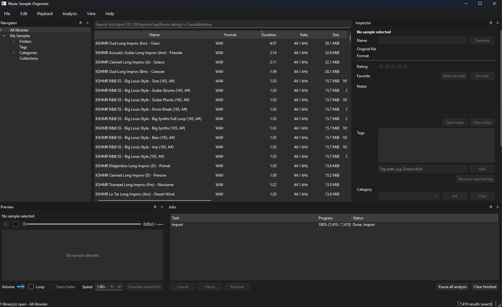

# Music Sample Organizer

**Find the right sample fast.** Point it at your sample folders and it reads everything, works out
BPM and key, draws waveforms, and lets you search, audition, rate, tag and drag samples straight into
your DAW. It all runs on your computer: no account, no cloud, no subscription, nothing uploaded.

## Why you'd want it

- **Your folders stay where they are.** Nothing is moved, renamed, copied or rewritten. The app keeps
  its own catalog and never touches the audio.
- **BPM and key, worked out for you.** Every sample is analyzed in the background. Tempo and key that
  are already in a file name (like `Loop_124bpm_Am.wav`) show up right away, and you can always
  override what the analysis says.
- **Search that understands music.** Type `kick bpm:120..130 key:Am rating:>=3` and get exactly that,
  across thousands of samples, instantly.
- **Audition instantly.** Press Space to play, loop a sample, change its speed, and see its waveform.
- **Drag into your DAW.** Drag one sample or a whole selection straight onto a track.
- **Rate, favorite, tag and sort.** Stars, favorites, tags like `Drums/Kick/Acoustic`, categories,
  notes and collections. Everything updates the moment you click, and Ctrl+Z undoes it, even after
  a restart.
- **Survives a messy drive.** Rename or move a file and it keeps its tags and ratings. Unplug an
  external drive and its samples show as offline rather than disappearing.

**Formats:** WAV, AIFF, FLAC, MP3, Ogg, Opus, AAC/M4A, ALAC, WMA, WavPack, CAF and more.

## Getting started

1. **Install it.** Run the Windows installer (`MusicSampleOrganizer-<version>-windows-x64.msi`). It adds
   Music Sample Organizer to the Start menu and the desktop. There is no public download yet; the
   installer is built from source, see [Building an installer](docs/BUILDING.md#windows-installer-msi).
2. **Add your sample folders.** Click **Add sample folder…** (or File → Add Folder, Ctrl+Shift+O) and
   pick a folder. Add as many as you like: a whole drive of packs works fine.
3. **Let it scan.** The Jobs panel at the bottom shows progress. You can browse and search while it
   runs; BPM, key and waveforms fill in as the analysis gets to them.
4. **Find and use sounds.**
   - Browse folders, tags and categories on the left, or type in the search box at the top.
   - Click a sample and press **Space** to hear it.
   - Click the stars to rate it, press **F** to favorite it, and drag it into your DAW.
   - Right-click a sample to show it in Explorer, copy its path or copy the file.

## Searching

Type words to match names, folders, tags and notes. Add filters to narrow it down:

| Type this | To find |
| --- | --- |
| `kick snare` | samples matching both words |
| `"metallic impact"` | that exact phrase |
| `kic*` | anything starting with "kic" |
| `bpm:140..155`, `bpm:>=120`, `bpm:120` | a tempo range, a minimum tempo, or about 120 BPM |
| `key:Am`, `key:F#minor`, `key:unknown` | a musical key, or samples without a detected key |
| `tag:Drums/Kick`, `tag:Kick` | a tag and everything under it; a single name matches at any level, and a merged tag is still found by its old name |
| `category:Bass`, `folder:"Packs/Goa"`, `collection:Favorites` | a category, folder or collection (`folder:/Drums` works too) |
| `duration:<2s`, `size:>1MB` | one-shots under two seconds, files over a megabyte |
| `rate:44.1k`, `channels:2`, `bits:24`, `format:flac` | technical details |
| `rating:>=4`, `favorite:true`, `available:true` | your ratings and favorites; skip offline files |
| `(tag:Drums OR tag:Percussion) AND NOT tag:Acoustic` | combine filters with AND, OR, NOT and brackets |
| `name:kick`, `path:loops`, `notes:dusty` | text in one field only |
| `analyzed:tempo`, `analyzed:none` | samples that have (or haven't) been analyzed yet |

If something is mistyped, the search box points at the problem instead of guessing.

## Keyboard shortcuts

These work while the sample list has focus:

| Key | Does |
| --- | --- |
| Space | Play / pause |
| Esc | Stop |
| 1–5, 0 | Rate 1–5 stars, clear the rating |
| F | Favorite / unfavorite |
| Delete | Remove from the library (the file on disk is left alone) |

These work everywhere: Ctrl+Z undo, Ctrl+Y redo, Ctrl+F search, Ctrl+Shift+O add a folder, Ctrl+O open a
library, Ctrl+Shift+N new library. You can change any of them in Preferences.

## Good to know

- **Where your catalog lives:** `%LOCALAPPDATA%\MusicSampleOrganizer` (for example
  `C:\Users\<you>\AppData\Local\MusicSampleOrganizer`). Your samples stay in their own folders.
- **Several libraries:** File → New Library keeps separate collections apart (say, "Work" and
  "Personal"), and you can search up to eight at once. File → Open Library opens one made on another
  machine.
- **Analysis in the background:** it runs as a separate, throttled process so the app stays smooth.
  You can pause or cancel it from the Jobs panel at any time.
- **Offline, always:** the app never connects to the internet.
- **Headphones unplugged?** If the audio device disappears, a notice with a **Retry** button appears
  in the preview panel, and preview switches back on its own once a speaker is available. Pick another
  output in the preview panel's **Output device** menu.
- **Huge selections:** if you select a very long list and only part of it has loaded yet, rating,
  favorite, delete and analyze ask you to wait a moment instead of acting on only part of it.
- **Coming next:** reviewing duplicates side by side (the app already fingerprints every sample to
  find them), a waveform browser, and copying samples into a library.
- **Command line:** there is also an `mso` tool for scripting and batch jobs; see
  [docs/COMMAND_LINE.md](docs/COMMAND_LINE.md).

## For developers

Building, the code layout, CI and the technical design are in [docs/DEVELOPING.md](docs/DEVELOPING.md)
and [docs/BUILDING.md](docs/BUILDING.md). Music Sample Organizer is free software under the
[GNU GPL v3](LICENSE).
