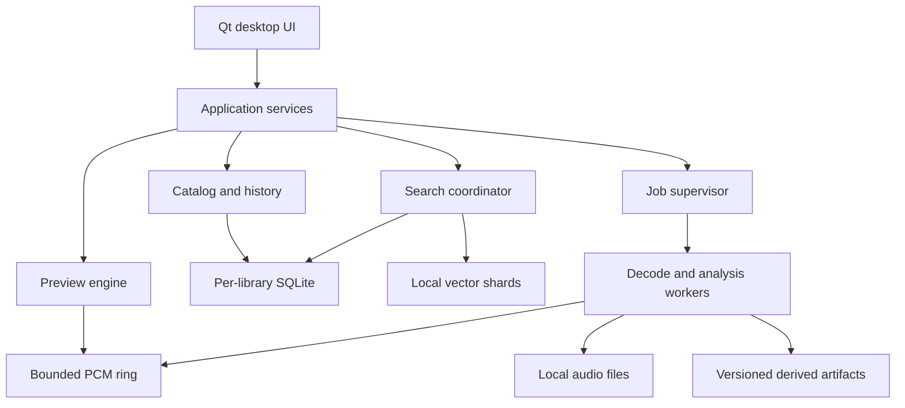

# 02 — Component architecture and execution model

## 1. System shape

Use a modular C++ application with isolated worker executables. Qt is confined to the UI/presentation boundary except where a deliberate adapter uses a Qt utility. Domain and DSP code must be testable without a GUI event loop. SQLite is authoritative for catalog state. Sidecars are disposable derived data; source audio and user metadata are not disposable.



The diagram shows responsibility, not permission to share database connections or write from workers. All worker results return through the supervisor and catalog writer.

## 2. Module and target boundaries

| Target/module | Owns | Must not do |
| --- | --- | --- |
| `mso_domain` | IDs, value types, requirements invariants, command/query DTOs | Depend on Qt, SQLite, codecs or Windows headers |
| `mso_application` | Use cases, coordination, cancellation, event publication | Perform database I/O on the UI thread |
| `mso_catalog` | SQLite connections, migrations, mutations, history/outbox, projections | Decode audio or call model runtimes |
| `mso_files` | Windows path/handle identity, roots, watchers, reconcile, managed copy | Auto-delete files or infer equality from names |
| `mso_search` | Parser, typed AST, query planning, federation, ranking, cursors | Accept raw user SQL |
| `mso_audio` | Transport, resampling, preview DSP, audio-device adapter | Call inference or the database from callback |
| `mso_analysis` | Feature algorithms, job handlers, deterministic preprocessing | Write catalog metadata directly |
| `mso_models` | Pack validation, runtime, tokenization, model fingerprints | Download models or execute pack-supplied code |
| `mso_vectors` | Exact/ANN adapters, shard manifests, delta, rebuild | Treat ANN files as authoritative sample metadata |
| `mso_platform_win` | WASAPI/device details, process/job objects, file I/O, drag paths | Leak Win32 handles across domain API |
| `mso_ui` | Qt models/delegates, commands, panels, shortcuts | Own full-library arrays or issue synchronous SQL |
| `mso_worker` | Decoder, hash, DSP and inference job execution | Open SQLite for writes or initiate network access |
| `mso_bench` | Fixtures, measurements, machine-readable reports | Masquerade synthetic timings as production results |

Suggested source layout: `src/domain`, `src/application`, `src/catalog`, `src/files`, `src/search`, `src/audio`, `src/analysis`, `src/models`, `src/vectors`, `src/platform/windows`, `src/ui`, `src/worker`; `tests/{unit,integration,fault,corpus}`, `bench`, `cmake`, `migrations`, `docs/adr`. Create directories when used, not empty framework scaffolding.

## 3. Thread and process ownership

The UI thread owns every Qt item model and widget. Workers return immutable page DTOs tagged with query generation; queued UI delivery discards obsolete generations. `rowCount`, `data`, painting, sorting requests and selection handlers never block on disk. Qt models are not thread-safe; model notifications execute on their owning thread [S03].

A catalog writer is serialized per library; at most two writers run simultaneously across libraries through the global scheduler. Each connection belongs to one executor/thread and is never concurrently used. Global reader pool: maximum eight connections, lazily opened and fairly shared among active libraries. Thread-confined prepared statements and bounded page cache budgets belong to those connections. No writer transaction spans a decoder call or a user dialog.

One preview decoder worker is separate from the background-analysis worker job object. The playback callback consumes a single-producer/single-consumer PCM ring with preallocated buffers. Callback activity is independent of analysis CPU throttling. A source-generation counter invalidates old PCM after selection/seek; stale decoder writes cannot enter the new ring epoch. Transport commands are bounded, with repeated seeks coalesced to the newest target. Stop always has reserved command capacity.

Background workers are child processes. Default one inference-capable worker and up to two lightweight decode/probe workers, admitted by RAM and CPU budgets. Use Windows job objects for process-tree lifetime, memory/CPU limits and termination; cap the analysis group, never the GUI or audio output. Job-object CPU rate is a fraction of system cycles; detect unsupported enforcement and display the fallback status [S06]. Set ONNX and any BLAS/OpenMP thread counts explicitly to avoid nested pools [S08].

Worker isolation protects UI availability, but is not itself a complete security sandbox. Workers run without elevation, receive a restricted set of inherited file/mapping handles, use private named-pipe ACLs and job objects, and do not load arbitrary DLLs from sample directories. Scope further OS sandboxing only if the selected libraries support it without breaking local-file workflows.

## 4. Portable library layout

```text
<library>/
  library.json                  # UUID, format version, name; no secret/absolute device binding
  catalog.sqlite                # authoritative catalog, metadata, jobs, history
  media/                        # managed audio only, opaque UUID-based directories
  derived/waveforms/            # bounded/rebuildable peak tiles
  derived/features/             # chunked immutable feature payloads
  derived/vectors/<space-id>/    # shard files and atomic manifest
  backups/                      # verified catalog backups and manifest
  staging/                      # operation-owned temporary files
```

User-local state under `%LOCALAPPDATA%/MusicSampleOrganizer/`: workspace registry, root bindings, device configuration, cache quotas, model installations, logs, and `mirrors/<library-uuid>/`. Library-level tags, collections, profiles and history move with the catalog. Machine paths, current audio endpoint IDs and monitor layout are workstation-local. A library export can include portable layout presets as optional settings, not machine bindings.

`library.json` and DB identity must match. Detect two simultaneously mounted directories with the same library UUID; refuse to treat them as independent writable libraries. Provide an explicit Clone library operation that assigns a new UUID and records ancestry. Do not silently fork or merge. Managed paths are relative; never embed a drive letter as the authoritative sample location. Rebinding a root changes the local mapping, not every sample row.

SQLite WAL and coordinated locking require local supported storage [S01]. Writable catalogs on network shares, cloud placeholders and unsupported filesystems are rejected with a local migration/export path. This does not prohibit referenced audio on local exFAT removable media. A disconnected catalog cannot continue writing through its missing file handle.

## 5. Offline metadata mirror

This resolves two different cases: (A) audio root absent, catalog present; (B) the entire portable catalog volume absent. In A, all metadata stays fully available from the primary database. In B, browse/search reads a local mirror, marked read-only and timestamped. Playback is disabled for that library in mirror mode even if an old binding appears reachable; reopening and verifying the primary is required. No audio or replayable PCM is copied to the mirror.

On first open, produce a consistent baseline using SQLite's backup API into a local temporary mirror. Validate identity, schema and integrity; atomically publish it. Reads can use the primary immediately. Until the baseline finishes, display `Offline catalog preparing`; do not claim that a never-cached catalog can survive removal. Keep a prior valid mirror while refreshing. The online backup API supports incremental copying [S02].

Every primary metadata transaction appends a monotonic revision and a replay envelope to `catalog_outbox` in that same transaction. Envelope contains deterministic row upserts/deletes for the read model, profile/category/tag/collection changes, effective facts, and a payload schema version. It excludes worker leases, large history payloads, audio bytes and machine paths. The mirror applier consumes revisions in order, regenerates FTS projections, and advances its watermark atomically in its own SQLite transaction. Idempotent replay uses `(library_uuid, revision)`; a gap or unsupported envelope version causes baseline refresh. Mirror projections use the same normalized collation/tokenizer version as the primary.

Primary commit is authoritative and may succeed before mirror acknowledgement. UI success says saved; mirror status separately says `Offline catalog current through revision N` or `Updating`. A disconnect during lag falls back to the last successfully mirrored revision; show the gap if known. This bounded-loss-of-freshness limitation is explicit, not data loss in the primary. Clean close/safe eject waits for the mirror to reach the committed revision. Retain outbox envelopes until mirror acknowledgement; cap backlog at 256 MiB, after which flag baseline-required and retain the prior valid mirror instead of unbounded growth. Never prune an event still needed by a separate durable consumer; consumers have distinct cursors.

Mirror disk usage is approximately an additional metadata catalog plus FTS, and can be several GiB. Reserve space during setup; if it cannot be created, report that whole-catalog disconnect fallback is unavailable. Existing available sample metadata is never replaced with an empty mirror. On reconnect, primary identity and schema are verified, primary wins, mirror refreshes; there are no offline edits to merge.

## 6. Import pipeline and managed copies

Stages: enumerate → identity/stat → bounded metadata probe → normalize → catalog batch commit → UI event. Bound the discovery channel to 4,096 entries/16 MiB, probe results to 1,024 entries/16 MiB, and DB batches to 500 rows or 100 ms worth of queued work (transaction duration measured separately). Backpressure stops enumeration rather than accumulating paths in RAM. Persist the root scan generation and directory frontier in SQLite for resumability.

Start the root watcher before scan, queue/coalesce hints, then reconcile them after the scan. Mark missing locations only after successful complete enumeration of the relevant subtree with no permission/I/O gaps. An interrupted or denied subtree is unknown, not empty. Scan cancellation commits no new results after its cancellation fence, preserves already committed records, and leaves a resume checkpoint. An imported count is committed rows, not merely discovered filenames.

Managed import is **copy**, never move. For each file: persist operation intent → open source with identity/stat → copy to unique `.partial` file in destination staging with streaming hash → flush → recheck source identity/stat → verify destination length/hash → atomically rename within destination volume → commit location/sample and operation state. Source changing during copy aborts/retries and never publishes a verified managed sample. The source is not deleted. A crash after file publication before DB commit leaves an operation-owned recoverable orphan; restart inspects the intent and hash, completes registration or records a review item. A failed copy must not leave a playable catalog location pointing at a partial file.

Destination naming uses opaque sample UUID plus preserved filename extension, not tags or display name. Collisions never overwrite existing media. Copy errors have per-file outcomes. Retrying uses the operation UUID for idempotency. Cancel removes only known temporary files owned by that uncommitted operation; a completed published copy is kept and reported. Removal from the catalog is a soft tombstone with history; deleting source/managed audio is outside ordinary catalog removal.

## 7. Filesystem tracking and relinking

Windows watcher: overlapped `ReadDirectoryChangesW` with bounded buffers and I/O completion delivery. Overflow/zero-byte result means enumerate again, not pretend that no changes occurred [S05]. Debounce write/rename bursts for 500 ms and require a stable stat observation before probing; continuously written files remain pending with a retry ceiling. Poll root presence periodically (2 seconds when active) and use device-change events as hints. Root availability is computed without opening every sample.

Use volume identity plus 128-bit file ID where supported, size/mtime and previously computed content hash as evidence. File IDs can be reused; after a deletion/recreation boundary they are not sufficient by themselves. Hard links are multiple locations only when explicitly associated or unambiguously discovered under the same scan policy; preserve separate independently imported samples by default. Case-only renames must work. Paths retain original spelling; normalized path keys account for the root's actual case-sensitivity mode, not unconditional lowercasing. Resolve through Win32 UTF-16 APIs; normalize display/search strings separately. Reject `..` traversal in persisted relative paths. Reparse points are not followed by default; enabling a specific root requires cycle detection and local-volume containment checks.

Relink review presents old/new paths, identity/hash evidence and ambiguity. Match precedence: still-valid existing handle/identity → same-volume confirmed rename → previously known full hash and compatible metadata proposal → weak size/name/partial hash proposal. Weak matches never automatically reassign annotations. Across drives or formats, equality needs the explicit duplicate/relink analysis path. Full rescans repair lost watcher history; NTFS USN journal acceleration is optional after correctness, never required or assumed available.

## 8. Preview data path

Open a verified local location in the preview worker → decode/trim codec priming as supported → produce float32 PCM → channel-layout-aware downmix and resample → optional preview DSP → shared PCM ring → output callback. Preserve source rate/frame positions in transport state and map to output frames rationally; do not accumulate floating-point time drift. Clamp invalid/non-finite samples, cap amplitudes for output safety, and use a short ramp on start/stop/seek to avoid discontinuities.

Default output is stereo WASAPI shared mode at the device rate, with 20–60 ms requested buffering and bounded prebuffering up to 250 ms. The exact actual device buffer is reported. Device failure stops the transport, clears generation, presents the error and permits choosing another endpoint. Never silently replay from the beginning after an endpoint change. An underrun emits silence and increments a counter; it does not block the callback. Sustained underruns automatically pause background jobs and present a diagnostic status.

Streaming is mandatory: do not load a long sample completely. PCM ring cap is 8 MiB; waveform accumulator cap is 16 MiB. Preview temporary PCM is memory-only and discarded on stop/library disconnect. Source disappearing during play stops as soon as detected, flushes the ring, and disables replay. Short buffered audio before detection is unavoidable; it is not persisted.

Peak overview uses min/max/RMS multiresolution tiles keyed by content revision, channel policy and generator version. Store source-frame spans in each tile; build coarse overviews bounded to 2,048 bins, with finer tiles on demand. No millions-of-small-files layout: pack tiles into append-only segment files with indexed offsets, checksums and compaction. Cache eviction removes only derived artifacts; metadata keeps their missing/stale status. The waveform browser paints a bounded visible row set using shared delegates, not a widget per sample.

## 9. Lifecycle

Startup opens settings, validates root/library identities, recovers incomplete operations, opens catalog read views and restores the last bounded page. It does not rescan or analyze everything before showing the window. Crashed `running` jobs become `interrupted`, then resumable `queued` only if input/profile are still valid and explicit run consent remains. Default after an unclean shutdown: background analysis remains paused until the user resumes; playback never auto-starts.

Shutdown stops admission, flushes commands, ends playback, asks workers to exit, cancels/leases outstanding tasks safely, commits pending catalog batches, catches up mirrors when available and closes SQLite connections. A watchdog terminates unresponsive children after 5 seconds; the next startup resolves their leases. Safe eject explicitly stops use of the chosen volume, drains the mirror, checkpoints/closes DB handles, and reports when this application's handles are released. It cannot guarantee other applications have released the device.
