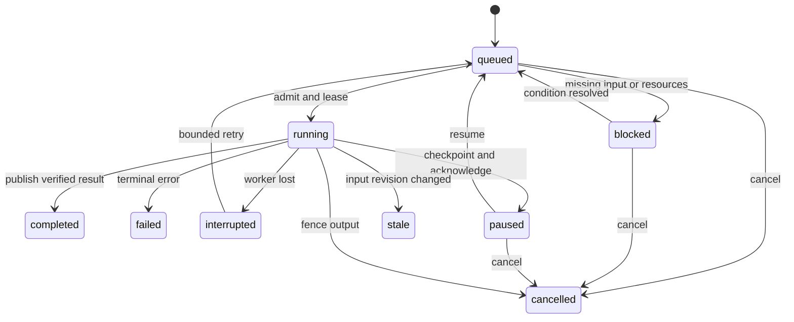

# 05 — Local audio analysis and retrieval

## 1. Analysis contract

Analysis never runs because import happened, the app started, a library reconnected, or a new model became available. The user starts a run against a selection and profile; restart/resume preserves that authorization only for the same frozen run. A changed file or profile produces a different input identity. No hidden analysis of newly discovered files under a previously completed run.

A profile is immutable once used: editing creates a new version/digest. Fields include enabled stages, algorithm versions, model-space digests, input channel policy, duration/window limits, precision, target rates, resource budgets, priority, and overwrite/force policy. A run stores the exact snapshot, not only a mutable profile name.

| Built-in profile | Stages | Starting limits |
| --- | --- | --- |
| Waveforms | Peaks/RMS tiles only | Streaming, no inference, 1 worker |
| Musical | Waveform, loudness, BPM, key, onset features | 2 workers; bounded windows for tempo/key |
| Search | Embeddings and classification suggestions | 1 CPU inference worker, batch 1 |
| Duplicates | Byte hash, decoded equality candidates, near-duplicate features | Streaming; pair candidates bounded |
| Full | Union of stages with shared decode where compatible | Resource admission still applies |

Global default: background analysis CPU hard cap 40% of system cycles where supported, memory budget 2 GiB across background workers, one inference worker, two lightweight workers, application I/O token bucket 50 MiB/s aggregate with 8 MiB burst and maximum two concurrent source reads. Preview uses a separate latency-priority lane; analysis yields when playback underruns or interactive searches are waiting. Application I/O accounting is a cooperative throughput budget, not a promise to control all OS read-ahead traffic.

Users may reduce limits; a task that cannot fit stays blocked rather than exceeding them. GPU is off by default, with a separately configured VRAM cap and monitored provider behavior. Failure to enforce GPU allocation bounds disqualifies that provider for a hard-budget profile. Model sessions unload after 5 minutes of inactivity; UI shows unloaded/loading/ready/error states.

## 2. Durable queue and dependencies

Run-level `pausing` waits for active stages to checkpoint or stop. Decoder streaming stages checkpoint only at validated seekable frame/packet boundaries plus algorithm state. Algorithms without serializable state restart the current file; expose `Current file will restart`. An opaque ONNX call is not assumed interruptible: allow it to finish within its deadline, discard output after cancellation, or kill its worker. Pause acknowledgement target is 2 seconds for streaming DSP and 5 seconds for inference; hard timeout kills an unresponsive worker. Cancelled work is never republished by a late message.

DAG per sample: bounded probe (if missing) → decode stream → waveform/features and/or model preprocessing → stage result validation → artifact publication → catalog commit → derived-index update. Hashing may stream independently; full decode can be shared within a single compatible task but never by retaining entire audio in RAM. Queue rows are disk-backed; scheduler reads at most 256 ready descriptors at once. Completion of one task does not grant permission to enable an unselected stage.

At most one active equivalent job per `(sample, content revision, stage, algorithm/config/model digest)` across runs; later runs may attach to the existing work or skip it. Persist this deduplication claim with a lease in the implementation migration; the reference schema's per-run uniqueness alone is insufficient. Stale leases are reclaimed on startup. Fair scheduling rotates libraries and runs, with user-started selected-sample analysis ahead of bulk tasks.

## 3. Decoder and media support

Release corpus must cover: WAV/RIFF PCM and float, RF64, AIFF/AIFC supported PCM variants, FLAC, MP3, Ogg Vorbis, Ogg Opus, raw AAC/ADTS, M4A/MP4 AAC and ALAC, WavPack, CAF common PCM/ALAC variants and WMA where available in the approved FFmpeg build. Suffix is a hint; identify actual container/codec. Multi-audio-stream containers select the first default audio stream and expose a stream picker later; ignore video and album art for playback. Encrypted/DRM media is unsupported with a clear error. MIDI is not audio and is not imported as a playable sample.

Baseline tested ranges: 8–192 kHz, 1–8 channels, integer 8/16/24/32-bit and float32/64 source representations, mono/stereo output preview. Greater rates/channels may be supported by the decoder but are capability-tested rather than silently downcast. Read sizes, allocation arithmetic and frame counts use checked 64-bit values. A long file is streamed; analysis profile limits may skip it or sample windows. Preview itself has no arbitrary short-sample-only limit.

Workers use a locally built FFmpeg subset with networking disabled and allowed local handle I/O. Dynamic linking and configuration-dependent licensing require an explicit dependency manifest and matching source/notice process [S07]; this specification does not assert that a codec license or model license has been cleared. Disable unneeded protocols/demuxers, playlist external references and unsafe nested opens. A file containing a URL cannot cause a network fetch [S09].

Seek, duration and sample alignment tests account for codec delay/priming, end padding and variable bitrate. Store exactness. Never call a codec duration estimate sample-exact. Downmix uses channel layout coefficients, not averaging arbitrary channels. For musical/embedding mono input, use documented equal-energy/peak-safe coefficients and record them in the preprocessing digest.

## 4. DSP outputs

**Waveforms:** signed min/max plus RMS per bin, multiresolution, source-frame positions, versioned endianness/header. Coarse tiles must represent the entire known duration; when only part has decoded, show the covered region, not a misleading flat remainder. Draw unknown/empty audio distinctly.

**BPM and beats:** initial deterministic algorithm: mono resample to 22,050 Hz; 1,024-point Hann STFT, hop 256; positive spectral flux onset envelope; robust local normalization; autocorrelation/tempogram candidate search over 40–240 BPM; evaluate half/double hypotheses; dynamic-programming beat path for sufficiently rhythmic audio. Store primary BPM, alternatives, beat times and confidence separately. UI/manual values allow 20–400 BPM. Analyze up to 120 seconds using distributed windows with positions and a coverage report; a Full-duration option changes the profile. Reject reliable BPM for insufficient repeated transients, silence and short one-shots rather than forcing a number. Loop length can resolve octave ambiguity only with explicit loop evidence and a recorded method.

**Key:** harmonic-weighted chroma accumulated over bounded windows, tuning offset estimation, compare major/minor profiles and retain top candidates. Use onset/percussiveness filtering to reduce drum influence. Store pitch class/mode, confidence and window agreement; non-tonal/silence outputs unknown. Key of a one-note sample may be a pitch estimate, not evidence of major/minor; expose pitch separately in observations if implemented. Manual override wins. Do not label all exotic modes as major/minor certainty.

**Loudness/features:** peak, RMS, crest factor, duration, spectral centroid/bandwidth/rolloff, zero-crossing rate and onset density. If implementing LUFS, use the applicable gated integrated algorithm with conformance fixtures; for very short samples mark insufficient duration instead of presenting unstable LUFS as a comparable fact. Preview loudness normalization is off by default; adding it later uses existing analysis with headroom, never forces analysis during playback.

Algorithm parameters above are starting implementation choices. Version each change and evaluate it; they are not claims of proven music-corpus accuracy. Deterministic reference outputs and held-out human labels determine acceptance.

## 5. Model pack and local natural-language retrieval

A model pack is a directory/archive containing inert data: manifest, ONNX graphs, tokenizer/vocabulary, preprocessing specification, labels/prompts, checksums, licenses, provenance and fixed golden input/output fixtures. No install script or executable plug-in. Pack importer validates path traversal, total expanded size, file count, hashes and a manifest schema before installing atomically. Never automatically fetch from a URL in a manifest.

Manifest fields: pack ID/version; model and weights origin/revision; SHA-256 per file; code and weights licenses separately; ONNX opset and tested runtime/providers; input/output tensor names/shapes/dtypes; audio sample rate, channel policy, window length/hop, normalization, padding/cropping, STFT/mel parameters; tokenizer normalization/vocabulary/sequence length/special tokens; vector dimension/normalization; quantization calibration and error report; taxonomy prompts; golden fixtures and expected tolerances. Hash all semantically relevant fields into `vector_space_digest`.

P5 model decision gate: choose an exact CLAP-family audio/text checkpoint with suitable provenance and distribution terms; export both encoders; verify numerical and retrieval parity; benchmark memory and CPU latency on Windows. CLAP is a joint audio/text approach, not a general conversational reasoner [S10]. A checkpoint is approved only after held-out evaluation for short musical samples, not because it performs well on environmental sounds. If no candidate meets redistribution/runtime/quality gates, P5 stays incomplete while core releases remain usable. Do not ship random placeholder vectors or claim semantic search is done because an interface exists.

Initially one embedding per sample from up to three deterministic 10-second windows (start, middle, end, deduplicated for short files) with a maximum 30 seconds processed; exact lengths obey the selected pack. For short samples, use the pack's validated pad/repeat policy; do not invent preprocessing. L2-normalize each vector, mean-pool, then renormalize. Keep coverage metadata. Segment-level search is a later optional profile that explicitly increases storage; the baseline capacity estimates assume one vector per sample. Text query embedding uses the matching text encoder and tokenizer. Cache at most 256 normalized text-query vectors per model space; no query logging by default.

English natural-language search is the initial evaluated language. Hebrew filenames/tags remain valid lexical content; semantic multilingual support is not claimed without a validated multilingual pack. Structured BPM/key/rate/duration filters come from the deterministic AST. Natural prose such as “warm gritty bass” supplies similarity intent; it does not assert reliable tempo or key facts. Hybrid search fuses lexical and semantic ranked windows with weighted RRF, initially equal weights and k=60; exact metadata filters always apply.

Classification scores against a fixed, versioned set of label prompts are suggestions, not calibrated probabilities. Return top 5 labels with raw score, margin and optional validated calibration. Threshold acceptance must be evaluated per class; a global cosine cutoff is not universally meaningful. Accepted labels create ordinary user metadata with history. Candidate taxonomy includes kick/snare/clap/hat/percussion/bass/lead/pad/pluck/vocal/FX/ambience/other, expandable by user-defined tags with separate unvalidated status.

## 6. Vector persistence and scale

USearch is the initial native C++ adapter because its documented interfaces include disk views and Windows support [S11]. This is a dependency choice subject to the native Windows spike, not proof of the target performance. Store normalized float16 reference embeddings in immutable segment files and build int8 index vectors only after cosine/recall parity evaluation. Exact reference evaluation uses float32 decoding of those reference vectors or original model outputs as specified by the benchmark.

For dimension d=512 and N=5,000,000: float32 is 10.24 GB (9.54 GiB); float16 is 5.12 GB (4.77 GiB); raw int8 is 2.56 GB (2.38 GiB), before graph/ID/alignment overhead. HNSW adjacency can add substantial space. Never assume the full graph plus vectors fits a 1–2 GiB resident budget. Memory mapping avoids eagerly copying all bytes; touched pages still occupy working set and cause I/O.

Use immutable shards of at most 100,000 vectors, loaded/viewed on demand with a maximum of two active mapped shard readers in the default budget, plus a delta of at most 10,000 vectors/32 MiB. Partition by stable ID range initially. Search visits every shard for exhaustive ANN candidate collection, sequentially/bounded-concurrently, and merges top candidates; arbitrary semantic routing that might skip relevant shards requires a separate recall gate. This choice may increase five-million-vector latency, which is an explicit benchmark risk. Cap mapping windows/working set through adapter ownership and admission; if the library API forces unbounded residency, change adapter implementation before claiming compliance.

Rebuild delta into new immutable shards off the UI path. Deletions/content changes create tombstones and revised entries. Search checks returned IDs/revisions against current metadata before returning. A model upgrade builds a separate vector space and index generation; old/new vectors never mix. Coverage counts reflect eligible/analyzed/indexed/stale samples separately. If a cache/index is evicted, embeddings can rebuild it without decoding audio; if embeddings are missing, explicit analysis is required.

Hard-filtered retrieval: enumerate eligible IDs when ≤10,000 and exact-score them; otherwise request ANN candidates with adaptive oversampling and apply filters/validity checks, up to 50,000 candidates or the query deadline. Return fewer results with a visible approximate/limited-coverage flag if the deadline/candidate cap is hit. Do not claim that postfiltering fixed top-100 ANN results yields exact filtered top-K. Offer an explicit slower exact filtered search streamed from disk; this is cancellable and not subject to interactive latency targets.

## 7. Duplicate semantics

| Level | Evidence | Label and limits |
| --- | --- | --- |
| Byte exact | Same file size and streaming SHA-256, followed by byte comparison for confirmed equality | Exact same file bytes; metadata chunks count |
| Decoded PCM equal | Full decode with same native sample rate, channel layout and canonical sample representation; streaming compare after hash prefilter | Cross-container/lossless equivalence under the pinned decoder/canonicalizer; not lossy-transcode equality |
| Near duplicate | Fingerprint/embedding candidate, duration/alignment and signal-similarity verification | Similar audio, never proof of equality; catches lossy transcodes, gain changes, trims when thresholds permit |

Byte hashing is an explicit stage except integrity hashing during an authorized managed copy. PCM canonicalization retains rate/channel order and exact integer samples for lossless integer sources; float sources use a documented IEEE representation with explicit NaN/negative-zero treatment. A canonical hash must include rate, layout and sample count. Do not downmix/resample/quantize and then call matching hashes proof of original equality. AAC/MP3/Opus encodings generally belong to near-duplicate detection after delay alignment.

Use size buckets for byte candidates, hash buckets for PCM candidates, and bounded nearest-neighbor candidates for near duplicates; never compare all N² pairs. Near verification may test lag, normalized cross-correlation and spectral distance on deterministic windows, then full verification where needed. Persist method, score, alignment, compared coverage and content revisions. Near-similarity is not transitive: connected components are navigation groups, and each pair retains evidence. Review shows A/B audition, sizes, paths and reasons. No auto-delete or automatic metadata/sample collapse at any level.

## 8. Advanced playback

Loop boundaries are source-frame integers; ensure `0 ≤ start < end ≤ frames` when exact. Use short crossfades only as a selected preview option and show that they alter audition. Pitch and speed independence uses a dedicated stretch adapter behind `mso_audio`; choose a validated library/algorithm at P4 and record its license. Do not assume all FFmpeg filters or a Rubber Band build are permissively redistributable. Basic resampling may implement coupled speed/pitch first, but it does not satisfy the independent-control gate.

V3 computes tempo ratio `target_bpm / effective_source_bpm` with quality limits and compensated processing latency. Beat-aligned looping requires a valid beat grid or explicit user markers. Confidence/half-time ambiguity is visible; no silent beat grid for unanalysed audio. Standalone sync means the internal transport; later VST3 receives host tempo/transport through the host's process context and uses a separately designed bounded local IPC protocol. VST audio-thread behavior must meet the same real-time rules.
